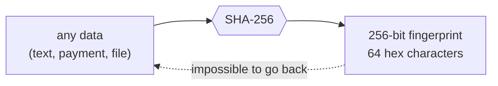

# Day 01 — Hashing & SHA-256

> Every blockchain is built on one simple tool: the **cryptographic hash function**. Today is about understanding it properly — and testing it like production code.

## What is a hash? (plain words)

A hash function takes **any input** — a word, a payment, a 2 GB file — and returns a **short, fixed-size fingerprint**. Bitcoin uses **SHA-256**, which always outputs 256 bits (64 hex characters).

Think of it like a fingerprint for data: tiny compared to the person, unique to them, and you can't rebuild the person from the print.

```
"Hello, Blockchain!"  →  7526b1d2bc17587443fbf1fafb27e95d70615bc7576c6e34c1f139c9ce857733
```



## The properties that make hashes useful for blockchain

| Property | Meaning | Why blockchain needs it |
|---|---|---|
| **Deterministic** | Same input → same output, always | Every computer can check the same data independently |
| **Fixed size** | Output is always 256 bits | Blocks can point to each other with a short reference |
| **Fast to compute** | Hashing is cheap | Checking is quick for everyone |
| **Avalanche effect** | 1 tiny change → ~50% of bits flip | Tampering is instantly visible |
| **One-way (preimage resistant)** | You can't reverse a hash to get the input | Enables Proof of Work and commitments |
| **Collision resistant** | Practically impossible to find two inputs with the same hash | A fingerprint can safely stand in for the data |

## Code

No runtime dependencies — just Node.js's built-in `crypto` module. Dev tools: Node's test runner, [fast-check](https://fast-check.dev) (fuzzing) and ESLint.

```bash
cd day-01
npm install                    # dev tools only (tests + lint)
npm start                      # hash a string, check determinism & fixed size
npm run avalanche              # 1-character change → how many bits flip?
npm run avalanche:stats        # average over 10,000 random 1-character edits
npm run preimage               # brute-force a hash with 5 leading zeros
npm run fingerprint            # SHA-256 fingerprint of a file
node src/hash.js "your text"   # hash anything you want
node src/file-fingerprint.js <file> <expected-hex>   # verify a file is unchanged
npm test                       # 20 tests: official vectors, fuzzing, edge cases
npm run lint
```

| File | What it shows |
|---|---|
| [`src/lib.js`](src/lib.js) | All logic as small, validated, side-effect-free functions |
| [`src/hash.js`](src/hash.js) | Basic SHA-256, determinism, fixed output size |
| [`src/avalanche.js`](src/avalanche.js) | Counts how many of the 256 bits change when you edit one character |
| [`src/preimage.js`](src/preimage.js) | Why hashes are one-way — the brute-force idea behind mining |
| [`src/file-fingerprint.js`](src/file-fingerprint.js) | Hashing and verifying files to detect tampering |
| [`test/lib.test.js`](test/lib.test.js) | NIST test vectors, fast-check property tests, QA regression tests |
| [`QA.md`](QA.md) | Bugs found while attacking my own code, and how each was fixed |

## Results from my run

**Avalanche effect** — changing `10 coins` to `11 coins`:

```
A: "Manish sends 10 coins"
   c8eb8907d8041eed49180b850883d1d7d3d06cfa5ad4a4d206ef3f31cd25b1dc
B: "Manish sends 11 coins"
   3e536e8a54b5d083c8456b6a109696f97efcb552f80fc20d6572a47a52ff90b5

Bits changed: 137 / 256 (53.5%)
```

One character changed and more than half the fingerprint flipped. That's why nobody can quietly edit a transaction.

**Is that just luck?** `npm run avalanche:stats` repeats the experiment 10,000 times with random messages:

```
Random 1-character edits : 10,000
Average bits flipped     : 127.93 / 256 (49.97%)
Fewest / most flipped    : 99 / 156
```

Almost exactly half, every time — what a good hash function should do. (The numbers vary slightly per run because the messages are random.)

**Brute-forcing leading zeros** (one-way-ness in action):

| Leading zeros | Attempts needed (my run) | Expected on average |
|---:|---:|---:|
| 1 | 23 | 16 |
| 2 | 193 | 256 |
| 3 | 13,699 | 4,096 |
| 4 | 37,213 | 65,536 |
| 5 | 742,576 | 1,048,576 |
| 6 | 16,325,200 (≈ 44 s) | 16,777,216 |

```
Target prefix : 00000
Found input   : "manish-742575"
Hash          : 000001370acec5b212ad7957f57cb6d908dcb3870de98c4c05e3fabb92d3fe5a
Attempts      : 742,576 in 1952 ms
```

Each extra zero makes the search ~16× harder on average. There is no shortcut — only guessing. Bitcoin miners do exactly this at enormous scale; that's **Proof of Work** (Day 02).

**Quality:** 20 / 20 tests pass, ESLint clean, `npm audit` 0 vulnerabilities. 8 issues found and fixed while attacking the code — see [QA.md](QA.md).

## Key takeaways

1. A hash is a **fingerprint**: tiny, unique, and impossible to fake.
2. The **avalanche effect** (~50% of bits flip) is what makes blockchain data tamper-evident.
3. **One-way + brute force = mining.** The only way to find a hash with a given pattern is to guess.
4. Hash the **exact bytes** you mean: "café" typed two different ways gives two different hashes (see QA F7).

## References

- [NIST FIPS 180-4 — Secure Hash Standard (SHA-256 specification)](https://csrc.nist.gov/pubs/fips/180-4/upd1/final)
- [NIST — SHA-256 example values (test vectors)](https://csrc.nist.gov/projects/cryptographic-standards-and-guidelines/example-values)
- [Bitcoin whitepaper — Satoshi Nakamoto (2008)](https://bitcoin.org/bitcoin.pdf)
- [Mastering Bitcoin, 3rd ed. — Antonopoulos & Harding (open source)](https://github.com/bitcoinbook/bitcoinbook)
- [Node.js `crypto` documentation — `createHash`](https://nodejs.org/api/crypto.html#cryptocreatehashalgorithm-options)
- [Bitcoin Developer Guide — Block chain (how hashes link blocks)](https://developer.bitcoin.org/devguide/block_chain.html)

## Coming next

**Day 02 — Blocks, chains & Proof of Work:** put hashes inside blocks, link each block to the previous one's hash, mine them with the brute-force search from today, and watch the whole chain break when one block is edited.
