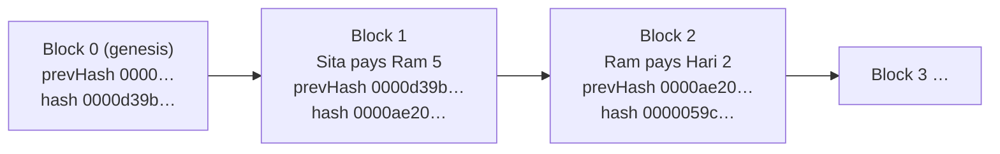

# Day 02 — Blocks, chains & Proof of Work

> Yesterday's hash becomes today's glue. Put data in a **block**, give every block the **hash of the block before it**, and make each block **expensive to create**. That is the whole trick behind an immutable ledger.

## The idea in four steps (plain words)

1. **A block is a box with a label.** The box holds data (payments). The label is the box's SHA-256 hash, the fingerprint from Day 01.
2. **Every box also holds the previous box's label** (`prevHash`). Change an old box and its label changes, so the next box now points to a label that no longer exists. The chain is broken, and anyone can see where.
3. **Labels are hard to make.** A label is only accepted if it starts with a set number of zero bits (the **difficulty**). The only way to find one is to keep changing a counter (the **nonce**) and hashing again. That guessing is **mining**, and the work it takes is the **Proof of Work**.
4. **So rewriting history means redoing the work** for the edited block *and every block after it*, faster than the honest network keeps adding new ones.



### What exactly gets hashed

```
block hash = SHA-256( [version, index, prevHash, timestamp, difficulty, nonce, SHA-256(data)] )
```

Each field has a fixed type and its own slot in a JSON array, so two different blocks can never be serialised to the same bytes (see QA F3). The data is hashed separately first. In Bitcoin that slot holds the **Merkle root** of all transactions (Day 04).

### Difficulty in bits

The hash is read as a 256-bit number and must be **below 2^(256 − d)**, which is the same as starting with **d zero bits**. Every extra bit doubles the expected work: about **2^d guesses** on average. Bitcoin uses the same rule with a target number (encoded in the header's `bits` field, see exercise 3).

| Term | Plain meaning |
|---|---|
| **Block** | A box of data + a header (index, time, prevHash, difficulty, nonce) |
| **prevHash** | The previous block's hash, the link in the chain |
| **Genesis block** | Block 0, fixed by the rules. Everyone starts from the same one |
| **Nonce** | A counter the miner changes until the hash is small enough |
| **Difficulty** | How many leading zero bits the hash needs (2^d guesses on average) |
| **Proof of Work** | The valid hash itself: cheap to check, expensive to find |

## Code

No runtime dependencies (Node.js `crypto` only). Dev tools: Node's test runner, [fast-check](https://fast-check.dev) and ESLint.

```bash
cd day-02
npm install
npm start               # mine a 5-block chain at 16 bits and validate it
npm run tamper          # edit block 1 → watch the chain break → re-mine to "repair" it
npm run difficulty      # measured attempts & time for 4–20 bits (≈ 25 s)
npm run retarget        # evening: the chain adjusts its own difficulty to a target block time
npm run ex:easy         # exercise solutions (see exercises/)
npm run ex:medium
npm run ex:challenge
npm test                # 40 tests: properties, attacks, audit regressions, exercises
npm run lint
```

| File | What it does |
|---|---|
| [`src/block.js`](src/block.js) | Block header encoding, hashing, difficulty check, mining (pure functions) |
| [`src/chain.js`](src/chain.js) | Genesis, `validateBlocks()` (returns *where* and *why* a chain breaks), `Blockchain` class, difficulty adjustment |
| [`src/demo.js`](src/demo.js) | Builds the demo chain (fixed timestamps, so the hashes are the same on every machine) |
| [`src/tamper.js`](src/tamper.js) | The tamper story, step by step |
| [`src/difficulty.js`](src/difficulty.js) | Difficulty vs. work, measured |
| [`src/retarget.js`](src/retarget.js) | Evening improvement: difficulty adjustment demo |
| [`test/`](test/) | Morning tests, QA regressions (F1–F8) and evening audit (E1–E6) |
| [`QA.md`](QA.md) | Every bug found while attacking the code, and how it was fixed |
| [`exercises/`](exercises/) | 3 exercises with tested solutions |
| [`notes.pdf`](notes.pdf) | Printable study guide |

## Results from my run

**A 5-block chain at 16 bits** (`npm start`):

```
#  data                      nonce      hash (first 16 hex)  prevHash (first 16 hex)
0  Day 02 genesis — Learning    145549  0000d39b694b706e     0000000000000000
1  Sita pays Ram 5 coins         36720  0000ae20c4515493     0000d39b694b706e
2  Ram pays Hari 2 coins         21787  0000059caabc359e     0000ae20c4515493
3  Hari pays Gita 1 coin         96206  0000ae62be3fc208     0000059caabc359e
4  Gita pays Sita 3 coins         5882  0000acbcb8c34e77     0000ae62be3fc208

Mined 4 blocks: 160,599 hashes in 468 ms
Chain valid: true
```

Every hash starts with `0000` (16 zero bits), and every `prevHash` is the hash on the line above.

**Tampering** (`npm run tamper`), changing "5 coins" to "500 coins" in block 1:

```
1. Honest chain                              → VALID
2. Edit block 1: "Sita pays Ram 500 coins"   → INVALID at block 1: hash does not match contents (block was edited)
3. Recompute its hash (no mining)            → INVALID at block 1: hash does not meet the Proof-of-Work target (not mined)
4. Re-mine block 1 only                      → INVALID at block 2: prevHash does not point to the previous block (chain broken)
5. Re-mine blocks 1–4                        → VALID

Rewriting history cost 491,216 hashes (4 blocks re-mined).
```

A one-line lie cost almost half a million hashes, and that is on a 5-block toy chain where nobody else is mining. On Bitcoin the attacker must redo the work faster than the whole honest network adds new blocks.

**Difficulty vs. work** (`npm run difficulty`, 8 fixed sample blocks per level):

| Difficulty (zero bits) | Avg attempts (my run) | Expected (2^d) | Avg time per block |
|---:|---:|---:|---:|
| 4 | 17 | 16 | 0.24 ms |
| 8 | 262 | 256 | 1 ms |
| 12 | 3,580 | 4,096 | 12 ms |
| 16 | 46,606 | 65,536 | 143 ms |
| 20 | 905,326 | 1,048,576 | 2910 ms |

Each +4 bits ≈ 16× more work. The attempt counts are the same on every machine (fixed samples); the times depend on your CPU (~330,000 hashes/s here, single-threaded JavaScript).

**Quality:** 40 / 40 tests pass, ESLint clean, `npm audit` 0 vulnerabilities. 8 issues found in the first draft (morning) and 6 more in the evening audit, all fixed with a failing test first. See [QA.md](QA.md).

## Key takeaways

1. **Hash links make edits visible**: one change breaks that block *and* every link after it.
2. **Proof of Work makes edits expensive**: a valid hash is cheap to check and costly to find, about 2^d guesses.
3. **The validator is the security.** A chain is only as safe as the rules nodes check: target met, difficulty from the *rules* (not from the block), our genesis, correct links, sane timestamps.
4. **Hash exact, canonical bytes.** `JSON.stringify` quietly turns `{a: undefined}` into `{}`. Two different payloads, one hash (evening E1).

## References

- [Bitcoin whitepaper, Satoshi Nakamoto (2008): §3 Timestamp server, §4 Proof-of-Work, §11 Calculations](https://bitcoin.org/bitcoin.pdf)
- [Bitcoin Developer Guide: Block chain overview, Proof of Work](https://developer.bitcoin.org/devguide/block_chain.html)
- [Bitcoin Developer Reference: block headers & target nBits](https://developer.bitcoin.org/reference/block_chain.html)
- [Mastering Bitcoin, 3rd ed., ch. 11 "The Blockchain" & ch. 12 "Mining and Consensus" (open source)](https://github.com/bitcoinbook/bitcoinbook)
- [Dwork & Naor (1992): Pricing via Processing or Combatting Junk Mail, the origin of Proof of Work](https://www.wisdom.weizmann.ac.il/~naor/PAPERS/pvp.pdf)
- [Adam Back (2002): Hashcash, a denial of service counter-measure](http://www.hashcash.org/papers/hashcash.pdf)
- [ethereum.org: Proof-of-Work (and why Ethereum moved to Proof-of-Stake)](https://ethereum.org/en/developers/docs/consensus-mechanisms/pow/)
- [RFC 8785: JSON Canonicalization Scheme (why "same data → same bytes" needs rules)](https://www.rfc-editor.org/rfc/rfc8785)

## Evening update

An independent audit this evening found **6 more issues** (2 medium, 4 low), all fixed with a failing test first. Full table in [QA.md → Evening audit](QA.md#evening-audit).

- **The big one (E1): different payloads, same block hash.** `JSON.stringify` drops `undefined`, turns `NaN` into `null`, `-0` into `0`, and lets an object's `toJSON()` decide what gets hashed. `{amount: 500, toJSON: () => ({amount: 5})}` hashed exactly like `{amount: 5}`. Now a strict canonical encoder (sorted keys, plain JSON values only) either encodes a value exactly or refuses it.
- **E2: the ledger changed when *you* changed your variable.** The chain stored the caller's object by reference. Blocks and their data are now deep-frozen copies of the exact bytes that were hashed.
- **E3–E6:** unhashed extra fields were accepted, `addBlock` could append blocks its own validator rejects, payloads had no size limit, and a bad clock value silently switched off the 2-hour future rule.
- **Improvement: difficulty adjustment.** Like Bitcoin (every 2016 blocks), the chain can now retune its difficulty every 5 blocks to hit a target block time, at most ±2 bits (×4) per step. Every block's difficulty is re-derived and checked by the validator. `npm run retarget`:

```
Target: 100 ms per block · retarget every 5 blocks · max ±2 bits per step

Blocks    Difficulty  Avg time/block  Avg hashes/block
1–5           8 bits         2.1 ms             231
6–10         10 bits         6.8 ms           1,109
11–15        12 bits        18.8 ms           4,984
16–20        14 bits        27.0 ms           6,883
21–25        16 bits       163.9 ms          45,797
26–30        15 bits        66.6 ms          22,970
31–35        15 bits        40.1 ms          13,296
36–40        16 bits       114.7 ms          33,888
```

  It climbs from 8 to 16 bits and then settles around the target (block times are random, and one bit is a 2× step, so it wobbles; your numbers will differ).
- **Exercises:** [find where a chain breaks, reproduce the whitepaper's "6 confirmations" maths, and verify Bitcoin's real Proof of Work from the `bits` field](exercises/README.md).

**Quality now:** 40 / 40 tests pass, ESLint clean, `npm audit` 0 vulnerabilities, 0 high / medium findings open.

## What I'd explore next

- **Time-warp attacks:** miners choose their own timestamps. Bitcoin's median-time-past rule and its 2016-block off-by-one show why difficulty logic is consensus-critical (known issue K1).
- **Chain work, not chain length:** when two valid chains compete, nodes pick the one with the most total work (Σ 2^d), not the most blocks. That is Day 04.
- **Mining economics:** why ASICs replaced CPUs, what a mining pool shares, and why Ethereum switched to Proof of Stake.

## Coming next

**Day 03 — Keys, signatures & transactions:** today anyone could write "Sita pays Ram 5 coins". Tomorrow only Sita can, using a secp256k1 key pair and a digital signature.
