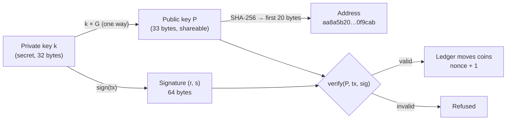

# Day 03 — Keys, signatures & transactions

> Day 02's chain had a hole: anyone could write "Sita pays Ram 5 coins" into a block. Today only **Sita** can, because the payment must carry a **digital signature** that only her **private key** can make, and everyone can check with her **public key**.

## The idea in plain words

1. **A private key is a secret number.** On secp256k1 (the curve Bitcoin and Ethereum use) it is any whole number from 1 to *n* − 1, where *n* ≈ 1.16 × 10^77. Like the PIN only you know, but impossible to guess.
2. **The public key is computed from it, one way.** Multiply the curve's starting point *G* by the secret: `P = k × G`. Going forward is fast; going back (finding *k* from *P*) is the "discrete log problem", which no computer can do for numbers this big. Like mixing paint: easy to mix, impossible to un-mix.
3. **The address is a short fingerprint of the public key.** Like an account number you can share with anyone.
4. **A signature is a stamp that depends on both the secret and the exact message.** Anyone with the public key can check it. Change one bit of the message and the stamp no longer fits.
5. **A transaction is a signed message** ("send 5 coins to this address, this is my payment number 0, on this network"). The ledger only moves coins when the signature checks out.



### What exactly gets signed

```
signed bytes = JSON[ "learning-blockchain/transfer", version, chainId, from, to, amount, nonce ]
tx id        = SHA-256(signed bytes)          ← the signature is NOT part of the id
signature    = ECDSA-secp256k1(SHA-256(signed bytes)), low-S, 64 bytes (r ‖ s)
```

Every field is there for a reason, and each one blocks a real attack (see [QA.md](QA.md)):

| Field | Plain meaning | Attack it blocks |
|---|---|---|
| `from` | Sender's public key | Signing "as Sita" with another key |
| `to`, `amount` | Who gets how much (whole coins only) | Editing the payment after signing; rounding tricks |
| `nonce` | "This is my payment number 0, 1, 2…" | **Replay**: sending the same signed payment twice |
| `chainId` | Which network this is for | **Cross-chain replay**: a testnet payment reused on mainnet (Ethereum: EIP-155) |
| domain string | "This is a transfer" | Reusing a signature made for something else |

### Two ways to keep balances

| | **Account model** (Ethereum, this repo) | **UTXO model** (Bitcoin) |
|---|---|---|
| State | A balance + nonce per address | A set of unspent "coins" (outputs), each locked to a key |
| A payment | "Subtract from A, add to B" | "Spend these outputs, create new ones" |
| Replay protection | The nonce | Each output can be spent only once |

### Key terms

| Term | Plain meaning |
|---|---|
| **secp256k1** | The elliptic curve `y² = x³ + 7` (mod a huge prime) used by Bitcoin and Ethereum |
| **Private key** | Secret number *k*; whoever knows it owns the coins |
| **Public key** | The point `k × G`, written compressed as 33 bytes (`02`/`03` + x) |
| **Address** | Short hash of the public key (Bitcoin: RIPEMD-160(SHA-256), Ethereum: last 20 bytes of Keccak-256) |
| **ECDSA** | The signature scheme: a signature is two numbers (r, s) |
| **Low-S** | Rule that s ≤ n/2, so each signature has exactly one valid form (BIP 62/146, EIP-2) |
| **Nonce** | Per-account payment counter (not the mining nonce from Day 02) |

## Code

No runtime dependencies (Node.js `crypto` only). Dev tools: Node's test runner, [fast-check](https://fast-check.dev) and ESLint.

```bash
cd day-03
npm install
npm start          # 3 wallets, 2 signed payments, balances
npm run attack     # Mallory tries 13 ways to steal from Sita
npm run bench      # signing vs verifying speed
npm test           # 26 tests: known answers, properties, fuzzed ledger invariant, attack regressions
npm run lint
```

| File | What it does |
|---|---|
| [`src/keys.js`](src/keys.js) | Private key → public key → address; strict low-S ECDSA sign/verify; wallets that never print their secret |
| [`src/transaction.js`](src/transaction.js) | The signed transfer: exact signed bytes, tx id, create, verify (snapshot-then-check) |
| [`src/ledger.js`](src/ledger.js) | Account ledger: balances + nonces, replay & cross-chain checks, all-or-nothing batches |
| [`src/demo.js`](src/demo.js) | The story: Sita → Ram → Hari |
| [`src/attack.js`](src/attack.js) | 13 attacks, each must be refused |
| [`src/bench.js`](src/bench.js) | Sign/verify timing |
| [`test/`](test/) | Unit, property and fuzz tests, one regression test per QA finding |
| [`QA.md`](QA.md) | Findings from attacking the code, and the fixes |

## Results from my run

**Wallets and payments** (`npm start`). Addresses are fixed (demo keys come from names, never do that for real money); signatures change every run because ECDSA uses a fresh random number each time:

```
1. Three wallets (private key → public key → address)
   Sita  public key 03517f04fb1e…  address aa8a5b204a46be63be0862c239ac0911e70f9cab
   Ram   public key 0373909eba93…  address 6e0a062d96a1606b28a32aa0344a8df87cc7d57b
   Hari  public key 023b79d26e5d…  address 0007bbbef172346c50861982feac4783c547087e

2. Genesis: Sita starts with 100 coins on chain "lb-devnet"

3. Signed payments
   Sita → Ram  30  id c26b26c0768a…  signature 5c4eefc2d987… (64 bytes)
   Ram  → Hari 10  id a857da68a6d6…  signature 3482e7256e7e… (64 bytes)

4. Balances after both payments
   Sita   70 coins   next nonce 1
   Ram    20 coins   next nonce 1
   Hari   10 coins   next nonce 0
   total 100 (supply 100: no coins created or destroyed)
```

**Mallory's attacks** (`npm run attack`):

```
 1. REFUSED  Sign as Sita with Mallory's own key
 2. REFUSED  Change 5 coins to 50 after Sita signed
 3. REFUSED  Redirect Sita's payment to Mallory
 4. REFUSED  Replay the same signed payment twice          → nonce 0 already used (replay)
 5. REFUSED  Replay a testnet signature on this chain      → cross-chain replay
 6. REFUSED  Flip s → n − s (a second valid-looking signature)
 7. REFUSED  Spend more than the balance                   → has 100, sends 101
 8. REFUSED  Send 0.1 coins (fractions)
 9. REFUSED  Send 2^53 + 1 coins (precision loss)
10. REFUSED  Pay to a fake address "__proto__"
11. REFUSED  Batch: 1 good + 1 bad payment, hope half sticks → nothing was applied
12. REFUSED  Garbage public key                            → not a point on secp256k1
13. REFUSED  Getter: amount reads 1 when checked, 100 when paid

Mallory tried 13 attacks: 13 refused, 0 got through.
```

In the first draft, **8 attacks like these got through** (replays, the s → n − s twin, fractions, half-applied batches, `__proto__`…) and a garbage key crashed it. A 10th problem (the getter trick) was found while attacking the second draft. All are in [QA.md](QA.md).

**Speed** (`npm run bench`, 2,000 payments, single-threaded Node.js):

```
Signed   2000 payments in 1000 ms  (0.500 ms each)
Verified 2000 payments in 1001 ms  (0.500 ms each), all valid: true
```

About 2,000 signature checks per second on one core, before any optimisation. Bitcoin Core uses the hand-tuned libsecp256k1 library, which is many times faster.

**Quality:** 26 / 26 tests pass, ESLint clean, `npm audit` 0 vulnerabilities, 10 findings fixed (2 high, 6 medium, 2 low). See [QA.md](QA.md).

## Key takeaways

1. **Ownership = knowing a secret number.** Coins are not "in" a wallet; the ledger just checks who can sign for an address.
2. **A valid signature is not enough.** Without a nonce and a chain id, a perfectly valid signature can be replayed again and again.
3. **One payment, one signature.** ECDSA allows a twin (r, n − s). Bitcoin and Ethereum both force low-S so signatures cannot be "reshaped".
4. **Check what you use, use what you checked.** Read untrusted input once, freeze it, and only then verify and apply it.

## References

- [SEC 2: Recommended Elliptic Curve Domain Parameters (secp256k1, §2.4.1)](https://www.secg.org/sec2-v2.pdf)
- [Bitcoin Developer Guide: Transactions, public keys, signatures](https://developer.bitcoin.org/devguide/transactions.html)
- [Mastering Bitcoin, 3rd ed., ch. 4 "Keys and Addresses" & ch. 8 "Digital Signatures" (open source)](https://github.com/bitcoinbook/bitcoinbook)
- [BIP 146: Dealing with signature encoding malleability (low-S)](https://github.com/bitcoin/bips/blob/master/bip-0146.mediawiki)
- [EIP-155: Simple replay attack protection (chain id)](https://eips.ethereum.org/EIPS/eip-155) · [EIP-2: low-S rule](https://eips.ethereum.org/EIPS/eip-2)
- [RFC 6979: Deterministic ECDSA (why the random k matters)](https://www.rfc-editor.org/rfc/rfc6979)

## Coming next

**Day 04 — Merkle trees, forks & consensus:** put these signed payments into blocks with a **Merkle root** (one fingerprint for hundreds of transactions), then let several nodes disagree and agree again with the longest-chain rule.
