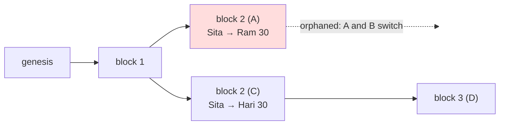

# Day 04 — Merkle trees, forks & consensus

> Day 03 gave us signed payments. Today they go into blocks. A **Merkle tree** squeezes hundreds of payments into **one 32-byte fingerprint** in the block header, and lets anyone prove "my payment is in that block" with about 10 hashes. Then several nodes mine at once, **disagree** (a fork), and **agree again** by following the branch with the most work.

## The idea in plain words

1. **A Merkle tree is a knockout tournament for fingerprints.** Hash every payment. Pair them up and hash each pair. Pair the results and hash again, until one hash is left: the **Merkle root**. Change one payment and the root changes.
2. **A Merkle proof is your path to the final.** To prove payment #737 is in a block of 1,000, you only need the 10 "opponents" it met on the way up, not all 1,000 payments. Phone wallets (SPV, Bitcoin whitepaper §8) work this way.
3. **A fork is two honest miners finding a block at the same moment.** News travels at a finite speed, so for a short time half the network sees one block and half sees the other.
4. **The rule that ends a fork: follow the branch with the most work.** Bitcoin calls it the "longest chain", but it is *most total work*, not *most blocks*. When the next block lands on one branch, everyone switches to it. Payments in the losing block are undone.

```
                       root = H(0x02 ‖ count ‖ top)        ← in the block header
                                  │
                ┌─────────────────┴─────────────────┐
             H(0x01‖AB‖CD)                         E        ← odd node moves up unchanged
          ┌──────┴──────┐                          │
     H(0x01‖A‖B)   H(0x01‖C‖D)                     E
       ┌──┴──┐       ┌──┴──┐                       │
       A     B       C     D                       E        ← A = H(0x00 ‖ tx id)
     tx0   tx1     tx2   tx3                     tx4

  Proof for tx2 = [ D , H(A,B) , E ]   → 3 hashes instead of 5 transactions
```



### The Merkle rules I used, and why

| Rule | Plain meaning | Attack it blocks |
|---|---|---|
| Leaf = `H(0x00 ‖ data)`, node = `H(0x01 ‖ left ‖ right)` | Leaves and inner nodes wear different "shirts" | A 64-byte inner node passed off as a transaction (second preimage, [RFC 6962](https://www.rfc-editor.org/rfc/rfc6962#section-2.1)) |
| Odd node moves up unchanged | No "pair with yourself" | `[a,b,c]` and `[a,b,c,c]` having the same root (Bitcoin's [CVE-2012-2459](https://bitcointalk.org/?topic=102395)) |
| Root also hashes the **number** of leaves | The root says *how many* payments | A proof lying about the position of a payment |
| Left/right worked out from `index` + `leafCount` | The proof carries only hashes | A proof that swaps sides to fit a different tree |

### Key terms

| Term | Plain meaning |
|---|---|
| **Merkle root** | One hash that stands for every transaction in the block |
| **Merkle proof** | The sibling hashes on the path from one leaf to the root (log₂ n of them) |
| **SPV** | "Simplified Payment Verification": checking a payment with headers + a Merkle proof, without downloading every block |
| **Fork** | Two valid blocks with the same parent |
| **Reorg** | A node switches to another branch; blocks on the old branch are undone |
| **Orphan** (in this code) | A block whose parent this node has not seen yet; kept and connected later |
| **Work** | Expected number of guesses to find a block = 2^bits. A chain's work is the sum over its blocks |
| **Stale block** | A valid block that ended up off the winning chain (wasted work) |

## Code

Builds directly on Day 03: blocks carry Day 03's signed transfers, and every node replays them with Day 03's `Ledger`. No runtime dependencies (Node.js `crypto` only; needs Node ≥ 20).

```bash
cd day-04
npm install
npm start           # 1,000 payments → one Merkle root, a 10-hash proof
npm run fork        # 4 nodes, a double spend, a split network, a reorg
npm run sim         # random networks: slower messages → more forks
npm run attack:v1   # the naive v1 and the 4 attacks that broke it
npm run spv         # evening: a phone wallet checks a payment with headers only
npm run attack:evening  # evening audit attacks E1, E2 (now refused)
npm run ex:easy     # exercises (see exercises/README.md)
npm test            # 44 tests: known answers, property/fuzz tests, attacks, exercises
npm run lint
```

| File | What it does |
|---|---|
| [`src/merkle.js`](src/merkle.js) | Merkle root, proof and `verifyProof` (never throws) |
| [`src/block.js`](src/block.js) | Block header (with Merkle root), header hash, Proof of Work miner |
| [`src/node.js`](src/node.js) | Full node: checks blocks, keeps all branches, most-work fork choice, orphans, reorgs |
| [`src/network.js`](src/network.js) | Seeded peer-to-peer simulator with message delays |
| [`src/spv.js`](src/spv.js) · [`src/spv-demo.js`](src/spv-demo.js) | Evening: light client (headers only + Merkle proofs) |
| [`src/demo.js`](src/demo.js) · [`src/fork.js`](src/fork.js) · [`src/sim.js`](src/sim.js) | The three runs below |
| [`qa/v1-attack.js`](qa/v1-attack.js) | My first, naive version and the attacks on it |
| [`QA.md`](QA.md) | Findings, fixes and proving tests |

## Results from my run

**Merkle tree** (`npm start`, 1,000 real signed payments from Day 03; root and hashes below are after the evening fix E1, which puts each signature into its leaf):

```
1. 1,000 signed payments → one Merkle root
   root ba173f791b04f47b9c3fcc2fab6463b00d3b082e4e3924d51f50e79a08107166

2. Proof that payment #737 is inside
   10 sibling hashes = 320 bytes
   (all 1,000 ids would be 32,000 bytes, 100× more)
   verify(payment #737) → true

3. Same proof, but the payment says 2 coins instead of 1 → false
   Same payment, claimed at position #738 → false

4. Proof size grows by ONE hash each time the block doubles
           1 payments →  0 hashes (0 bytes)
          10 payments →  4 hashes (128 bytes)
       1,000 payments → 10 hashes (320 bytes)
   1,000,000 payments → 20 hashes (640 bytes)
```

**A fork, step by step** (`npm run fork`). A–B and C–D are close (50 ms); other links are slow (300 ms). Sita signs two payments with the *same* nonce: 30 coins to Ram and 30 coins to Hari. Only one can survive.

```
t=0.5 s  B mines block 1. Everyone has it.
t=1.0 s  A mines block 2 with "Sita → Ram 30". C mines a different block 2 with "Sita → Hari 30".
t=1.1 s  The network is split:
         A:0000fa08@2  B:0000fa08@2  C:000da756@2  D:000da756@2
         A sees: Ram 30, Hari 0   |   D sees: Ram 0, Hari 30
t=2.0 s  Both blocks reached everyone. Equal work, so each node keeps the one it saw FIRST
t=2.0 s  D mines block 3 on top of C's block. That branch now has more work.
t=2.30 s  A switches branch: throws away 1 block
t=2.30 s  B switches branch: throws away 1 block

End:     A:000553d5@3  B:000553d5@3  C:000553d5@3  D:000553d5@3
         All nodes agree: true.  Balances everywhere: Ram 0, Hari 30
         Ram's payment was "confirmed" for about 1 second, then disappeared.
```

This is exactly why exchanges wait for several confirmations (Day 02's evening: ~6 blocks).

**Random networks** (`npm run sim`, 5 equal miners, 300 blocks per run, seed 4):

```
message delay   wasted blocks   branch switches   deepest   all agree
     10 ms         1 ( 0.3 %)            1           1      true
    100 ms        18 ( 6.0 %)           30           2      true
    300 ms        48 (16.0 %)           85           2      true
   1000 ms       113 (37.7 %)          151           4      true
```

When messages take as long as a block, more than a third of all mining is wasted. Bitcoin's 10-minute block time is far longer than the few seconds a block needs to cross the network, so stale blocks are rare.

**Quality:** 25 / 25 tests pass, ESLint clean, `npm audit` 0 vulnerabilities, 8 findings fixed (1 high, 5 medium, 2 low). See [QA.md](QA.md).

## Key takeaways

1. **One hash can stand for a thousand payments**, and proving one of them costs only log₂(n) hashes.
2. **Tag your hashes.** Without separate leaf/node tags and a count, a Merkle tree can be fooled in at least three ways.
3. **"Longest chain" means most work.** Counting blocks lets an attacker win with cheap, easy blocks.
4. **Forks are normal; finality is a probability.** A payment one block deep can still vanish. Each extra block makes that less likely.

## References

- [Bitcoin: A Peer-to-Peer Electronic Cash System, §7 "Reclaiming Disk Space" and §8 "Simplified Payment Verification"](https://bitcoin.org/bitcoin.pdf)
- [RFC 6962 §2.1: Merkle Hash Trees (leaf/node prefixes)](https://www.rfc-editor.org/rfc/rfc6962#section-2.1)
- [Bitcoin Developer Guide: Block chain, Merkle trees and forks](https://developer.bitcoin.org/devguide/block_chain.html)
- [CVE-2012-2459: duplicate transactions and the Merkle tree](https://nvd.nist.gov/vuln/detail/CVE-2012-2459)
- [Mastering Bitcoin, 3rd ed., ch. 11 "The Blockchain" & ch. 12 "Mining and Consensus" (open source)](https://github.com/bitcoinbook/bitcoinbook)
- [Ethereum.org: Merkle Patricia Trie](https://ethereum.org/en/developers/docs/data-structures-and-encoding/patricia-merkle-trie/)

## Evening update

An independent audit this evening found **3 more issues** (1 medium, 2 low), all fixed with a failing test first. Full table in [QA.md → Evening audit](QA.md#evening-audit).

- **The big one (E1): same hash, different block.** The Merkle leaves were Day 03 transaction ids, and those leave the signature out. So a copy of a block with a broken signature had the **same** block hash. Sent to a node *before* the real block, the fake sat in the orphan pool and the real block was thrown away as a "duplicate": the node got stuck one block behind and Ram's 30 coins were missing. Now each leaf is `[txId, signature]`, so the block hash covers every byte that matters. Bitcoin fixed the same class of problem with the SegWit witness commitment (BIP 141).
- **E2: free re-checks.** An invalid block was forgotten after being refused, so sending it 20 more times cost ~2 s of replays at height 100. Now permanently invalid blocks (and their children) are remembered: 20 resends cost 86 ms, only the first check. Temporary failures (a block from the future) are deliberately **not** remembered. This is only safe because of E1.
- **E3:** `chain()` / `ledgerAt()` with an unknown hash crashed inside the node; now a clear `RangeError`.
- **Improvement: a light client (SPV)**, like a phone wallet (whitepaper §8). It keeps only headers, follows the most work and checks a payment with a Merkle proof. `npm run spv`:

```
1. A full node has 30 blocks with 600 payments: 205,611 bytes
   The phone keeps only the 30 headers:            5,986 bytes (34× less)

2. "Sita paid Ram 25 coins in block 5" + a 5-hash proof (160 bytes)
   phone says: paid, 26 confirmations deep

3. Server claims it was 250 coins → refused: Merkle proof does not match the block
4. Payment in a block that lost a fork → refused: block is not on the best chain (stale branch)
5. Header without real Proof of Work → rejected: not enough Proof of Work
```

- **Exercises:** [proof length by arithmetic, spot the difference top-down (1 changed payment of 1,024 found with 21 comparisons), and one proof for 8 payments (27 hashes instead of 78)](exercises/README.md).

**Quality now:** 44 / 44 tests pass, ESLint clean, `npm audit` 0 vulnerabilities, 0 high / medium findings open.

## What I'd explore next

- **Bitcoin's real block format**: 80-byte headers, double SHA-256 and the compact `nBits` target, then verify a real block's Merkle root from its transactions (the light client stores ~200 bytes per header today; Bitcoin needs 80).
- **Merkle Patricia tries and Verkle trees**: Ethereum commits to the *state* (every balance), not just the transactions, so a light client can prove "Sita has 70 coins" too. Day 05 starts there.
- **Selfish mining (Eyal & Sirer, 2014)**: a miner that hides blocks can earn more than its fair share with about a third of the hash power; simulate it with today's network.

## Coming next

**Day 05 — Ethereum & the EVM:** from a coin ledger to a world computer. Accounts, gas, opcodes and storage layout, explored with ethers.js against a local Hardhat node.
