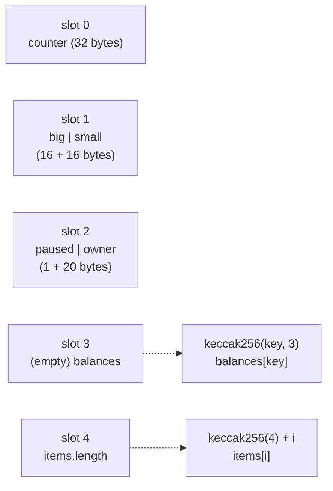

# Day 05 — Ethereum & the EVM

> Days 01–04 built a coin ledger: who owns how many coins. Ethereum keeps that ledger **and** runs programs on it. Every node runs the same tiny computer, the **EVM** (Ethereum Virtual Machine), on the same inputs and must get the same result. Today I looked inside it: accounts, gas, opcodes and storage, using ethers.js against a local Hardhat chain, and I wrote a mini-EVM whose gas matches the real one step for step.

## The idea in plain words

1. **Two kinds of account.** An *externally owned account* (EOA) is a person with a private key (Day 03). A *contract account* has no key; it has **code** and **storage**. Both have a balance and a **nonce** (a counter of transactions sent, which also stops replays).
2. **The EVM is a calculator with a stack.** Code is a list of one-byte instructions called **opcodes** (`ADD`, `SSTORE`, `JUMP` …). Each one takes numbers off a stack of 256-bit numbers and puts its answer back on top.
3. **Gas is the price list.** Every opcode costs gas: `ADD` 3, reading storage 100–2,100, writing a new value 22,100. You pay `gas used × gas price`. Gas stops endless loops (you run out) and makes people pay for the work they ask thousands of nodes to do.
4. **Storage is a wall of 2²⁵⁶ lockers of 32 bytes.** Solidity fills them in order: slot 0, slot 1 … and packs small values into one locker. Mappings and arrays are scattered with `keccak256` so they never collide.

```
 PUSH1 2   PUSH1 3    ADD       PUSH1 0    SSTORE                 gas
 ┌───┐     ┌───┐     ┌───┐     ┌───┐                              3 + 3 + 3 + 3
 │ 2 │     │ 3 │     │ 5 │     │ 0 │  ← key                       + 22,100  (0 → 5 in an
 └───┘     │ 2 │     └───┘     │ 5 │  ← value   → storage[0] = 5             empty, cold slot)
           └───┘               └───┘
```



### Key terms

| Term | Plain meaning |
|---|---|
| **EOA** | An account controlled by a private key (a person or a bot) |
| **Contract account** | An account controlled by its code; it has storage |
| **Nonce** | Transactions sent so far; each transaction must use the next number |
| **Gas** | Units of work. A plain ETH transfer is always 21,000 gas |
| **Gas price** | What you pay per unit (in gwei = 10⁻⁹ ETH). Fee = gas used × gas price |
| **Opcode** | One EVM instruction, one byte (`0x01` = `ADD`, `0x55` = `SSTORE`) |
| **Cold / warm** | First touch of a storage slot in a transaction costs 2,100 ("cold"); later touches 100 ("warm") — EIP-2929 |
| **Refund** | Clearing a slot back to 0 gives some gas back (4,800), at most 1/5 of the gas used — EIP-3529 |
| **Storage slot** | One 32-byte locker; a contract has 2²⁵⁶ of them, all 0 until written |

### Storage write costs (what `SSTORE` charges)

| Write | Cost (cold slot) | Why |
|---|---:|---|
| 0 → x (new value) | 22,100 | Every node must keep a new 32-byte value forever |
| x → y (change) | 5,000 | The slot already exists |
| x → x (no change) | 2,200 | Nothing changes, you only pay for the access |
| x → 0 (clear) | 5,000 − 4,800 refund | Freeing state is rewarded |

## Code

Builds on Days 01–04: the same hashes (now `keccak256`), signatures and nonces (Day 03), now inside the account model instead of a coin ledger. Solidity compiles **offline** with solcjs (see [`tools/README.md`](../tools/README.md)); everything runs on a **local** Hardhat chain, no real money.

```bash
cd day-05
npm install
npm start               # the demo below on an in-process Hardhat chain
npm run node            # or: start a local node in one terminal …
npm run demo:localhost  # … and run the demo against it in another
npm test                # 45 tests: unit, storage layout, accounts, attacks, differential fuzz vs Hardhat
npm run lint            # ESLint + Solhint
npm run slither         # static analysis (after npm run compile)
```

| File | What it does |
|---|---|
| [`src/evm.js`](src/evm.js) | mini-EVM: ~70 opcodes, mainnet gas rules (warm/cold, SSTORE refunds, memory), assembler, raw-bytecode deployer |
| [`src/storage.js`](src/storage.js) | Where Solidity puts a variable: mapping slot, array slot, unpack packed values |
| [`contracts/Layout.sol`](contracts/Layout.sol) | Small contract laid out to show packing, mappings and arrays; deposit / withdraw / owner-only actions |
| [`src/demo.js`](src/demo.js) | Accounts, a transfer, a deployment, raw storage, gas, mini-EVM vs Hardhat |
| [`test/evm.diff.test.js`](test/evm.diff.test.js) | 150 random programs on both EVMs: every step's gas must match |
| [`exercises/README.md`](exercises/README.md) | Three exercises on packed storage, warm reads, and differential testing |
| [`QA.md`](QA.md) | Findings, fixes and proving tests |

## Results from my run

`npm start` (Hardhat in-process chain, chain id 31337):

```
2. Sita sends Ram 1 ETH
   gas used          21,000   (the fixed price of any plain transfer)
   gas price         1.875 gwei
   fee               0.000039375 ETH = gas used × gas price
   Sita paid         1.000039375 ETH = 1 ETH + fee → true
   Sita's nonce now  1   (counts her transactions; stops replays)

3. Deploy Layout.sol
   predicted address 0xe7f1725E7734CE288F8367e1Bb143E90bb3F0512  (keccak256(rlp(Sita, nonce)))
   real address      0xe7f1725E7734CE288F8367e1Bb143E90bb3F0512  match: true
   deploy gas        736,081
   Layout (contract) 0xe7f1725E7734CE288F8367e1Bb143E90bb3F0512  balance     0.0 ETH  nonce 1  code 2952 bytes

4. Storage: 32-byte lockers, read raw with eth_getStorageAt
   slot 0  0x0000000000000000000000000000000000000000000000000000000000000001  counter = 1
   slot 1  0x0000000000000000000000000000000900000000000000000000000000000007  small = 7, big = 9 (packed)
   slot 2  0x000000000000000000000000f39fd6e51aad88f6f4ce6ab8827279cfffb92266  owner = 0xf39fd6e5…, paused = false
   slot 3  0x0000000000000000000000000000000000000000000000000000000000000000  mapping: empty on purpose
   slot 4  0x0000000000000000000000000000000000000000000000000000000000000002  items.length = 2
   balances[Ram] at keccak256(Ram, 3) = 0x9c35da83f880…  → 500 wei
   items[1]      at keccak256(4) + 1  = 0x8a35acfbc15f…  → 22

5. Gas of the same function, twice
   increment() 0 → 1   43,567 gas   (new value in an empty slot: 20,000 + cold 2,100)
   increment() 1 → 2   26,467 gas   (changing an existing value: 2,900 + cold 2,100)
   first write costs 17,100 gas more

6. Opcodes: "store 2 + 3, read it back, return it" = 0x600260030160005560005460005260206000f3
   pc  opcode    my gas  Hardhat gas
    0  PUSH1          3            3
    2  PUSH1          3            3
    4  ADD            3            3
    5  PUSH1          3            3
    7  SSTORE     22100        22100
    8  PUSH1          3            3
   10  SLOAD        100          100
   11  PUSH1          3            3
   13  MSTORE         6            6
   14  PUSH1          3            3
   16  PUSH1          3            3
   18  RETURN         0            0
   total gasUsed: mine 43,230, Hardhat 43,230  → match: true
   returned: 5
```

Two things surprised me:
- **Writing the same function twice costs 39 % less the second time** (43,567 → 26,467): the first call creates a value, the second only changes it.
- **`SLOAD` after `SSTORE` cost only 100**: the slot was already "warm" in this transaction.

**Differential fuzz test** (`npm test`): 150 random programs, each run twice, on my mini-EVM and on Hardhat's EVM: **10,134 opcode steps in 300 transactions, every step's gas identical**, plus identical storage, output and `gasUsed`.

**Quality:** 45 / 45 tests pass, ESLint + Solhint clean, `npm audit` 0 vulnerabilities, Slither 0 high / medium / low (6 informational, reviewed). 5 findings fixed (1 medium, 4 low). See [QA.md](QA.md).

## Key takeaways

1. **Ethereum = accounts + a shared computer.** Bitcoin tracks coins; Ethereum tracks accounts (balance, nonce, code, storage) and runs code that changes them.
2. **Gas is what keeps a world computer alive.** Every step has a price, so loops end and spam costs money. Storage is by far the most expensive thing you can do.
3. **Order of variables matters.** Solidity packs small values into one 32-byte slot; mappings and arrays live at `keccak256` addresses. Knowing this lets you read *any* contract's state directly.
4. **Check your model against the real thing.** Running the same programs on two EVMs found a mismatch no unit test of mine would have caught.

## References

- [Ethereum.org: Ethereum Virtual Machine](https://ethereum.org/en/developers/docs/evm/) and [Gas and fees](https://ethereum.org/en/developers/docs/gas/)
- [Ethereum Yellow Paper (Appendix G: fee schedule, Appendix H: instruction set)](https://ethereum.github.io/yellowpaper/paper.pdf)
- [evm.codes: interactive opcode reference with gas costs](https://www.evm.codes/)
- [Solidity docs: Layout of State Variables in Storage](https://docs.soliditylang.org/en/v0.8.24/internals/layout_in_storage.html)
- [EIP-2929: gas cost increases for state access opcodes (cold/warm)](https://eips.ethereum.org/EIPS/eip-2929) · [EIP-3529: reduction in refunds](https://eips.ethereum.org/EIPS/eip-3529)
- [ethers.js v6 documentation](https://docs.ethers.org/v6/) · [Hardhat Network reference](https://hardhat.org/hardhat-network/docs/reference)

## Coming next

**Day 06 — Solidity fundamentals:** writing contracts properly: types, functions, events, modifiers and errors, with a full Hardhat test suite.
