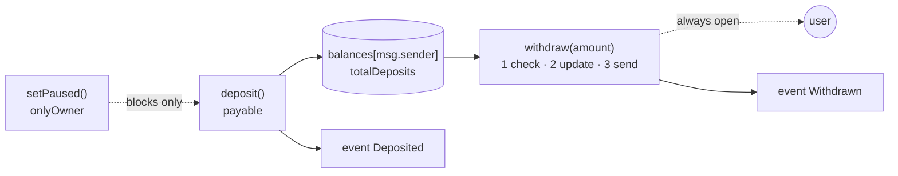

# Day 06 — Solidity fundamentals

> Day 05 looked inside the EVM. Today I wrote on top of it: a real Solidity contract, **LearningVault**, where anyone can deposit ETH and take out only their own. Small as it is, it uses almost every basic idea of the language: state, mappings, visibility, events, modifiers, custom errors and safe ETH transfers. Then I attacked it, measured it, and fixed what broke.

## The idea in plain words

1. **A contract is a program with its own bank account and memory.** Its *state variables* live in storage (the 32-byte lockers from Day 05) and survive between calls. *Local variables* exist only while a function runs.
2. **Every function says who may call it and what it may touch.** `external`/`public` decide who can call; `view` promises not to change state; `pure` promises not to even read it; `payable` allows ETH to come in.
3. **Failing loudly protects money.** A `revert` undoes *everything* the call did. Custom errors (`InsufficientBalance(available, requested)`) say why, cheaply.
4. **Events are the contract's public diary.** Apps read them off-chain; contracts cannot read them. The *order* of events matters because apps replay them.
5. **Sending ETH hands control to someone else's code.** So: **checks → effects → interaction.** Check the rules, update your own books, and only then send the money.

```
 BROKEN vault (sends first)                 LearningVault (updates first)

 withdraw(1) ─► send 1 ETH ─► attacker's    withdraw(1) ─► balance = 0 ─► send 1 ETH
                receive() ─► withdraw(1)                                    │
                 balance still 1 ► pays     attacker's receive() ─► withdraw(1)
                 again... vault drained                              ✕ ReentrantCall
```



### Key terms

| Term | Plain meaning |
|---|---|
| **State variable** | A value stored on-chain in the contract's storage; survives between calls |
| **`mapping`** | A key → value lookup table. You cannot list its keys (Solidity can't iterate it) |
| **`immutable` / `constant`** | Set once (constructor / compile time) and baked into the bytecode: no storage slot, cheap to read |
| **Modifier** | A reusable check wrapped around a function (`onlyOwner`, `whenNotPaused`, `nonReentrant`) |
| **Custom error** | A named, typed revert reason with data. Cheaper than a text message |
| **Event** | A log entry. `indexed` arguments can be searched by apps |
| **`payable`** | Marks a function that may receive ETH |
| **Data location** | `storage` (on-chain, permanent), `memory` (temporary copy), `calldata` (read-only call input) |
| **Interface** | A list of function signatures with no code; any contract that `is` it must provide them |
| **Reentrancy** | A contract you pay calls back into you before you finished updating your books |

## Code

Solidity compiles **offline** with solcjs (see [`tools/README.md`](../tools/README.md)). Everything runs on a **local** Hardhat chain: no real money, no testnet.

```bash
cd day-06
npm install
npm start               # guided tour of everything below, on an in-process chain
npm run node            # or: local node in one terminal …
npm run demo:localhost  # … and the tour against it in another
npm test                # 75 tests
npm run lint            # ESLint + Solhint
npm run slither         # static analysis (after: npx hardhat clean && npm run compile)
npm run qa:mutation     # break the contract 16 ways; every break must make a test fail
npm run ex:easy         # / ex:medium / ex:challenge : the exercise solutions
```

Node.js 20 or 22 (LTS) is recommended; Hardhat prints a warning on newer, unsupported Node versions but still works.

| File | What it does |
|---|---|
| [`contracts/LearningVault.sol`](contracts/LearningVault.sol) | The vault: deposit, withdraw own balance, owner-only pause, events, custom errors, reentrancy guard |
| [`contracts/StudyLog.sol`](contracts/StudyLog.sol) | A study diary that shows the types: `enum`, `struct`, array, mapping, `calldata`/`memory`/`storage`, `view` vs `pure` |
| [`contracts/interfaces/IVault.sol`](contracts/interfaces/IVault.sol) | The two-function interface every vault implements |
| [`contracts/exercises/VaultPlus.sol`](contracts/exercises/VaultPlus.sol) | Worked solutions to exercises 1, 2, 4, 9 |
| [`contracts/test/`](contracts/test) | Test-only helpers: a **deliberately broken** vault, an attacker, a recipient that rejects ETH, a re-depositor, a forced-ETH sender |
| [`src/demo.js`](src/demo.js) | The guided tour (`npm start`) |
| [`test/`](test) | 75 tests: behaviour, attacks, raw storage, gas, 200-run random test vs a JS model, QA regressions, exercises |
| [`qa/mutation.js`](qa/mutation.js) | Mutation testing harness |
| [`exercises/`](exercises) | 3 levels + runnable solutions |
| [`QA.md`](QA.md) · [`notes.pdf`](notes.pdf) · [`card/`](card) | Findings and fixes · printable study guide · LinkedIn cards |

## Results from my run

`npm start` (Hardhat in-process chain):

```
1. Deploy
   deploy gas     376,377
   runtime code   1385 bytes   (the constructor ran once and is gone)
   owner()        Sita   (immutable: lives in the bytecode, not in storage)

2. Deposit: payable function + event
   event          Deposited(account=Ram, amount=0.5, newBalance=1.5)
   Ram's first deposit  69,667 gas   (creates his storage slot: 0 -> value)
   Ram's second deposit 35,467 gas   (only changes it: value -> value)

3. Storage: the 32-byte lockers from Day 05, read raw with eth_getStorageAt
   slot 0  paused = 0        slot 1  _status (reentrancy guard) = 1
   slot 2  balances (mapping base) empty on purpose
   slot 3  totalDeposits = 3.5 ETH
   balances[Ram] lives at keccak256(Ram, 2)  -> 1.5 ETH

5. Pause: stops deposits, never withdrawals
   Ram deposits while paused   -> ContractPaused
   Hari withdraws 2 ETH while paused -> works

6. Reentrancy: the same attacker against two vaults
   VulnerableVault (sends first, updates after), victim has 5 ETH, attacker stakes 1 ETH:
      attacker ends with 6.0 ETH after 5 re-entries · vault holds 0.0 ETH   <- drained
   LearningVault (updates first + nonReentrant), same attack:
      re-entry refused with ReentrantCall · attacker ends with 1.0 ETH (its own stake) · vault still holds 5.0 ETH

7. A payout that fails reverts everything
   contract with no receive() asks for its money -> TransferFailed
   its recorded balance is still 1000 wei (the state change was rolled back)
```

Things that surprised me:
- **The second deposit costs half the first** (69,667 → 35,467 gas): Day 05's storage prices, seen from Solidity.
- **A test that "the attack fails" proves nothing until the same attack succeeds somewhere.** So the tests first drain a deliberately broken vault, then show `LearningVault` refusing the same attacker.
- **My first 19 tests all passed, yet 5 of 15 broken versions of the contract passed them too** (see QA.md).

**Quality:** 75 / 75 tests pass. ESLint + Solhint clean. `npm audit --omit=dev` 0 vulnerabilities. Slither: no real issue (8 results: intentional test contracts, false positives and info, all reviewed). **Mutation testing: 16 / 16 broken versions caught.** 6 findings fixed (1 medium, 3 low, 2 info). See [QA.md](QA.md).

## Key takeaways

1. **State is shared and permanent; locals disappear.** Where data lives (`storage`, `memory`, `calldata`) decides what it costs and who can change it.
2. **Update your books, then send the money.** And keep a guard as a second lock. Each layer was tested on its own.
3. **A pause button should stop new risk, not lock the exit.** My first version froze withdrawals too.
4. **Events are an API.** If they are emitted in the wrong order, apps that replay them see a history that never happened.
5. **Green tests are evidence, not proof.** Break your own code on purpose; if no test fails, the tests are not watching that behaviour.
6. **This is a learning vault, not an audited one.** Do not put real funds in it.

## Manual QA checklist

- [x] Compile with the pinned compiler (0.8.24)
- [x] Full test suite green
- [x] Solhint + ESLint clean
- [x] `npm audit` reviewed (see QA.md for the dev-toolchain note)
- [x] Unauthorized calls and boundary values tested (0, 1 wei, balance, balance + 1)
- [x] External call and reentrancy reviewed, attacker contract included
- [x] Failed payout reverts the state change
- [x] Pause / withdrawal trade-off decided and documented

## References

- [Solidity docs: Structure of a Contract](https://docs.soliditylang.org/en/v0.8.24/structure-of-a-contract.html) · [Contracts: visibility, modifiers, events](https://docs.soliditylang.org/en/v0.8.24/contracts.html) · [Types](https://docs.soliditylang.org/en/v0.8.24/types.html)
- [Solidity docs: Security considerations (reentrancy, checks-effects-interactions)](https://docs.soliditylang.org/en/v0.8.24/security-considerations.html)
- [Solidity docs: Errors and the revert statement](https://docs.soliditylang.org/en/v0.8.24/control-structures.html#revert)
- [Hardhat documentation](https://hardhat.org/docs) · [ethers.js v6](https://docs.ethers.org/v6/)
- [SWC-107: Reentrancy](https://swcregistry.io/docs/SWC-107)
- [OpenZeppelin ReentrancyGuard](https://docs.openzeppelin.com/contracts/5.x/api/utils#ReentrancyGuard) (why the guard flips between 1 and 2)

## Coming next

**Day 07 — ERC-20 tokens:** balances, allowances and transfer rules, built with OpenZeppelin, with fuzz and property-based tests.
