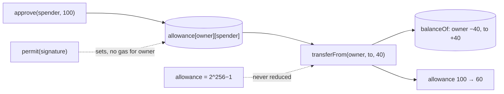

# Day 07 — ERC-20 tokens

> Day 06 moved ETH. Today I built the thing most of Ethereum actually moves: **tokens**. First a token written from scratch (`MiniToken`) so I could see every moving part, then the OpenZeppelin way (`LearningToken`), then a vault that spends *other people's* tokens (`TokenVault`) and has to survive the strange tokens that exist in the real world.

## The idea in plain words

1. **A token is a table inside a contract.** There are no coins to hold. "Ram owns 5 tokens" means `balanceOf[Ram] == 5 × 10¹⁸`. ERC-20 is only a *promise about function names*, so wallets and exchanges can talk to any token the same way.
2. **Decimals are a display trick.** The chain stores whole numbers. `decimals = 18` tells a wallet to show `balance ÷ 10¹⁸`. Split 1 token into 3 and one unit is left over: integer division rounds down.
3. **`transfer` moves your tokens. `approve` + `transferFrom` lets someone else move them.** An *allowance* is a permission with an amount, not a lock, and it is checked again every time it is used.
4. **Allowances are dangerous in two ways.** Lowering one can leak the old amount (the *approve race*), and an unlimited approval (`2²⁵⁶ − 1`) exposes everything you will ever hold to that spender.
5. **`permit` (EIP-2612) approves with a signature** (the same kind of signature as Day 03) instead of a transaction, so the owner pays no gas. Anyone may submit it, so code that uses it must not break when someone else did.
6. **Real tokens misbehave.** Some return nothing (USDT), some return `false`, some take a fee, some call you back. A vault must credit what *arrived*, not what was *requested*.

```
 approve then transferFrom                     permit (gasless approval)

 Ram ── approve(vault, 100) ──► token          Ram signs off-chain (no transaction)
 Ram ── deposit(100) ─► vault                     │
        vault ── transferFrom(Ram, vault, 100)    ▼
                ──► token moves Ram's tokens   anyone ── permit(sig) ──► token
        allowance 100 → 0                      allowance set, Ram's nonce +1
```



### Key terms

| Term | Plain meaning |
|---|---|
| **ERC-20** | The standard list of functions and events every fungible token offers |
| **Base unit** | The smallest indivisible amount, like a wei. 1 token = 10^decimals base units |
| **Allowance** | How much a spender may still move from an owner's balance |
| **`transferFrom`** | Move tokens from *someone else* to anyone, if the caller has an allowance |
| **Approve race** | Changing an allowance while the spender is spending it can let them take both amounts |
| **Permit (EIP-2612)** | Approve with a signed message; the nonce stops it being used twice |
| **Cap** | A ceiling on `totalSupply` that minting can never cross |
| **Fee-on-transfer** | A token whose receiver gets less than the sender sent |
| **`SafeERC20`** | A wrapper that handles tokens returning nothing or `false` |
| **Differential testing** | Run two implementations on identical inputs and demand identical results |
| **Mutation testing** | Break the code on purpose; a good test suite fails every time |

## Code

Solidity compiles **offline** with solcjs (see [`tools/README.md`](../tools/README.md)). Everything runs on a **local** Hardhat chain: no real money, no testnet.

```bash
cd day-07
npm install
npm start               # guided tour of everything below, on an in-process chain
npm run node            # or: local node in one terminal …
npm run demo:localhost  # … and the tour against it in another
npm test                # 167 tests (about a minute: two of them run hundreds of random programs)
npm run lint            # ESLint + Solhint
npm run slither         # static analysis (after: npx hardhat clean && npm run compile)
npm run qa:mutation     # break the contracts 34 ways; every break must make a test fail
npm run ex:easy         # / ex:medium / ex:challenge : the exercise solutions
```

Node.js 20 or 22 (LTS) is recommended.

| File | What it does |
|---|---|
| [`contracts/MiniToken.sol`](contracts/MiniToken.sol) | ERC-20 written from scratch, ~100 lines, with the same error names as OpenZeppelin |
| [`contracts/LearningToken.sol`](contracts/LearningToken.sol) | The OpenZeppelin way: ERC20 + Burnable + **Capped** + **Permit** + Ownable (mint) |
| [`contracts/TokenVault.sol`](contracts/TokenVault.sol) | A vault for *any* ERC-20: allowances, `SafeERC20`, fee tokens, permit front-running, reentrancy |
| [`contracts/exercises/TokenPlus.sol`](contracts/exercises/TokenPlus.sol) | Worked solutions to the exercises |
| [`contracts/test/`](contracts/test) | Test-only helpers: a **deliberately broken** vault, fee / no-return / returns-false / ghost / callback tokens, an attacker, an OpenZeppelin reference |
| [`src/demo.js`](src/demo.js) | The guided tour (`npm start`) |
| [`test/`](test) | 167 tests: one ERC-20 behaviour suite run on 3 tokens, permit, allowances, vault + weird tokens, **differential** (vs OpenZeppelin), **random vs a model**, raw storage, gas |
| [`qa/mutation.js`](qa/mutation.js) | Mutation testing harness |
| [`exercises/`](exercises) | 3 levels + runnable solutions |
| [`QA.md`](QA.md) · [`notes.pdf`](notes.pdf) · [`card/`](card) | Findings · printable study guide · LinkedIn cards |

## Results from my run

`npm start` (Hardhat in-process chain), abridged:

```
1. A token is just a table inside a contract
   totalSupply()          1,000,000,000,000,000,000,000 base units   = 1000.0 MINI

3. transfer: move tokens and announce it with an event
   gas: first transfer to Ram 51,615   second 34,503   (a NEW balance slot costs ~20,000 more, Day 05)

4. approve + transferFrom: letting a CONTRACT spend your tokens
   Ram deposits 100 without approving first -> ERC20InsufficientAllowance
   allowance(Ram, vault) = 100.0   balance(Ram) = 500.0   (approve moves nothing)
   allowance(Ram, vault) = 0.0   vault holds 100.0   Ram is credited 100.0

5. The approve race
   The spender front-runs with transferFrom(100), then spends the NEW 50 too -> took 150 units (Hari meant 100 or 50).

7. permit (EIP-2612)
   The RELAYER submits it and pays the gas. Ram sent no transaction, yet allowance = 50.0, nonce = 1.
   Replaying the same signature -> ERC2612InvalidSigner   (the nonce was used up)

8. Tokens that do not behave
   NAIVE vault  holds 1980 but credited 2000  (the LAST user to withdraw is robbed)
   TokenVault   credits what ARRIVED: requested 1000, received 990, solvent = true

9. A token with a callback hook tries to re-enter the vault
   The hook fired: true. Its second withdraw was refused with ReentrancyGuardReentrantCall.
   Inside the callback it saw vault balance 0 and total 0: effects were already applied.
```

Things that surprised me:
- **My hand-written token costs 34,443 gas per transfer; OpenZeppelin's costs 34,460.** Same algorithm, 17 gas apart. A battle-tested library is not magic, just careful.
- **Sending to a brand-new holder costs ~17,000 more** (51,543 vs 34,443 gas). That is Day 05's "a new storage slot is expensive", now inside a token.
- **An unlimited allowance saves gas** (37,249 vs 40,488 per `transferFrom`) because the allowance slot is not rewritten, but it is the riskiest permission you can give.
- **A "the attack fails" test needs a control.** The vault tests first show a naive vault going insolvent and giving free credit, then show `TokenVault` surviving the same tokens.
- **My 17-mutant first pass left 3 survivors in the vault tests** (see QA.md). All three were cases I had *designed* for but never actually tested.

**Quality:** 167 / 167 tests pass. ESLint + Solhint clean. `npm audit --omit=dev` 0 vulnerabilities. Slither: no real issue (3 results in production code, all explained in QA.md; the rest are the deliberately bad helpers). **Mutation testing: 34 / 34 broken versions caught.** 2 findings fixed (both test gaps). See [QA.md](QA.md).

## Key takeaways

1. **A token is a balance table plus a promise about names.** Everything else (allowances, events, decimals) is convention built on that.
2. **`approve` is a permission, not a payment.** It overwrites, it is re-checked at every use, and it can leak when changed under a spender's feet. Prefer exact amounts, or `permit`.
3. **Never trust `amount`; measure what arrived.** Fee tokens, no-return tokens and liars all break vaults that do.
4. **`permit` signatures are public once broadcast.** Code that consumes one must tolerate someone else having used it first.
5. **Test the standard, not one contract.** One behaviour suite ran on three tokens, and a differential test made OpenZeppelin the judge of mine.
6. **Break your own code on purpose.** Mutation testing found three behaviours I had designed and never tested.
7. **This is a learning token, not an audited one.** Do not put real funds in it.

## Manual QA checklist

- [x] Compile with the pinned compiler (0.8.24) and pinned OpenZeppelin (5.0.2)
- [x] Full test suite green, including the random and differential tests at full size
- [x] Solhint + ESLint clean
- [x] `npm audit` reviewed (see QA.md for the dev-toolchain note)
- [x] Boundaries tested (0, 1, balance, balance + 1, allowance + 1, cap, cap + 1, `2²⁵⁶ − 1`)
- [x] Unauthorized calls tested (mint, burnFrom, transferFrom, permit signed by the wrong key)
- [x] Weird tokens tested with a deliberately broken control for each
- [x] Reentrancy tested through all three entry points, plus read-only reentrancy
- [x] Slither reviewed, every result explained

## References

- [EIP-20: Token Standard](https://eips.ethereum.org/EIPS/eip-20) · [EIP-2612: Permit](https://eips.ethereum.org/EIPS/eip-2612) · [EIP-712: Typed structured data](https://eips.ethereum.org/EIPS/eip-712) · [ERC-6093: Standard errors](https://eips.ethereum.org/EIPS/eip-6093)
- [OpenZeppelin ERC20 docs](https://docs.openzeppelin.com/contracts/5.x/erc20) · [SafeERC20](https://docs.openzeppelin.com/contracts/5.x/api/token/erc20#SafeERC20)
- [SWC-114: Transaction order dependence (the approve race)](https://swcregistry.io/docs/SWC-114)
- [Solidity docs: Security considerations](https://docs.soliditylang.org/en/v0.8.24/security-considerations.html)
- [fast-check](https://fast-check.dev/) (property-based testing) · [Hardhat documentation](https://hardhat.org/docs)

## Coming next

**Day 08 — NFTs (ERC-721 and ERC-1155):** unique tokens, metadata, safe transfers, royalties.
