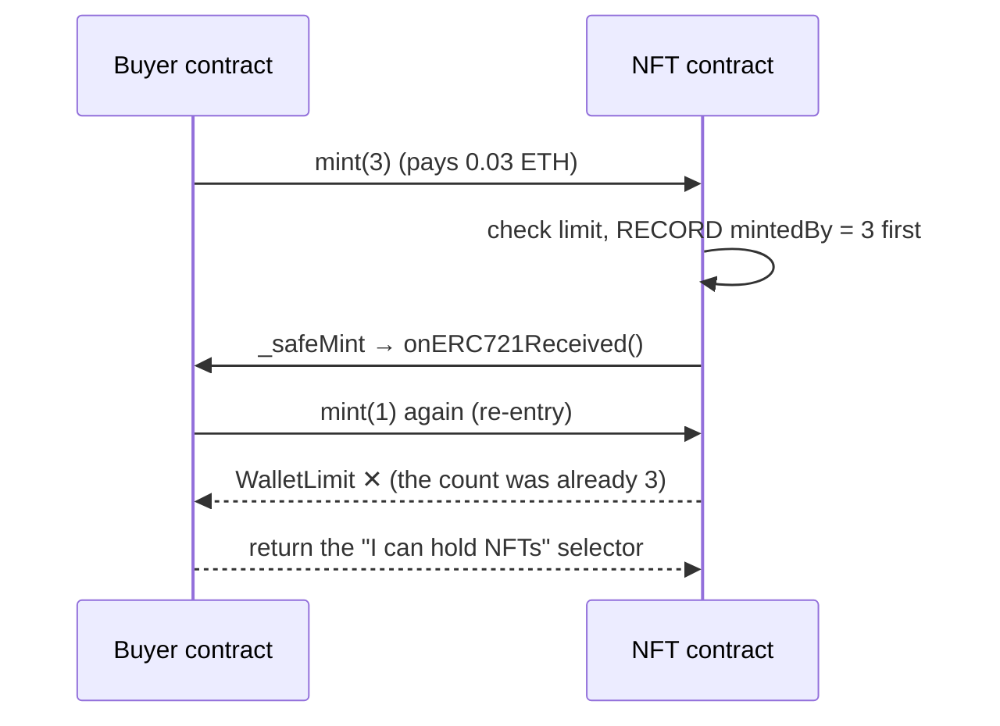

# Day 08 — NFTs: ERC-721 and ERC-1155

> Day 07's tokens were all the same: one LRN is worth any other LRN. Today's tokens are **unique**. Token #7 is not token #8. I wrote an NFT contract from scratch (`MiniNFT`), proved it behaves exactly like OpenZeppelin's, then built a small paid collection with royalties (`LearningNFT`) and a game-items contract where one id is a coin and another is one-of-a-kind (`GameItems`).

## The idea in plain words

1. **An NFT is a table: `tokenId → owner`.** Day 07's table was `address → amount`. Here every row is one numbered item with exactly one owner. "Ram owns NFT #7" means `ownerOf(7) == Ram`.
2. **The picture is not on the chain.** The contract stores a *link* (`tokenURI`) to a JSON file that names the image. The chain proves *who owns token #7*; the link says *what token #7 looks like*.
3. **Two kinds of permission.** `approve(Hari, 7)` lets Hari move token #7 once (wiped when it moves). `setApprovalForAll(market, true)` lets a marketplace move **every** token you own, now and later. The second is how most NFT scams steal.
4. **`safeTransferFrom` asks before sending.** Sending an NFT to a contract that does not know about NFTs locks it there forever. The *safe* version calls the receiver first (`onERC721Received`) and refuses if it does not answer correctly.
5. **That question is also a door.** Asking the receiver hands it control in the middle of your function. A buyer contract can call `mint` again from inside that call. Record limits **before** you mint, never after.
6. **Royalties (ERC-2981) are a question, not a rule.** `royaltyInfo(id, price)` answers "how much should the artist get". Marketplaces choose whether to pay.
7. **ERC-1155 is many tokens in one contract.** The table is `(id, owner) → amount`. Id 0 can be a coin (1,000,000 GOLD), id 2 a one-of-one (1 CROWN). Batches move several types in one transaction.

```
 ERC-20 (Day 07)          ERC-721 (today)               ERC-1155 (today)
 address  → amount        tokenId → owner               (id, owner) → amount

 Ram  → 500               #1 → Ram                      (GOLD,  Ram) → 1000
 Sita → 120               #2 → Ram                      (SWORD, Ram) → 5
                          #3 → Sita                     (CROWN, Ram) → 1   ← only 1 exists
```



### Key terms

| Term | Plain meaning |
|---|---|
| **NFT / ERC-721** | A token where every unit has its own number and one owner |
| **`tokenURI`** | The link to the token's metadata (name, description, image) |
| **ERC-165** | "Which standards do you speak?" `supportsInterface(0x80ac58cd)` = "yes, ERC-721" |
| **`approve` / `getApproved`** | Permission for one address to move one token |
| **`setApprovalForAll`** | Permission for an operator to move all your tokens |
| **`safeTransferFrom`** | A transfer that checks the receiver can hold NFTs |
| **`onERC721Received`** | The hook a receiving contract implements; it must return its own 4-byte selector |
| **ERC-2981** | Standard way to ask "what royalty does this token want on a sale?" |
| **Basis points** | Hundredths of a percent: 500 bps = 5% |
| **ERC-1155** | One contract, many token ids, each with its own supply (fungible or unique) |
| **Re-entrancy** | Being called again before your first call finished |

## Code

Solidity compiles **offline** with solcjs (see [`tools/README.md`](../tools/README.md)). Everything runs on a **local** Hardhat chain: no real money, no testnet.

```bash
cd day-08
npm install
npm start               # guided tour of everything below, on an in-process chain
npm run node            # or: local node in one terminal …
npm run demo:localhost  # … and the tour against it in another
npm test                # 99 tests (about 15 s; one runs 120 random programs)
npm run lint            # ESLint + Solhint
npm run slither         # static analysis (after: npx hardhat clean && npm run compile)
npm run qa:mutation     # break the contracts 34 ways; every break must make a test fail
```

Node.js 20 or 22 (LTS) is recommended.

| File | What it does |
|---|---|
| [`contracts/MiniNFT.sol`](contracts/MiniNFT.sol) | ERC-721 written from scratch (~190 lines), same error names as OpenZeppelin |
| [`contracts/LearningNFT.sol`](contracts/LearningNFT.sol) | The OpenZeppelin way: 100 supply, 0.01 ETH price, 3 per wallet, `.json` metadata, 5% royalty (ERC-2981) |
| [`contracts/GameItems.sol`](contracts/GameItems.sol) | ERC-1155: GOLD (1,000,000), SWORD (100), CROWN (exactly 1), batch minting with caps |
| [`contracts/test/Helpers.sol`](contracts/test/Helpers.sol) | Test-only: the OpenZeppelin reference, good / missing / wrong / refusing receivers, a **deliberately broken** `NaiveNFT`, a re-entrant attacker |
| [`src/demo.js`](src/demo.js) | The guided tour (`npm start`) |
| [`test/`](test) | 99 tests: one ERC-721 suite run on **both** MiniNFT and OpenZeppelin, collection rules, royalties, re-entrancy, ERC-1155, and a **differential fuzz test** |
| [`qa/mutation.js`](qa/mutation.js) | Mutation testing harness |
| [`QA.md`](QA.md) · [`card/`](card) | Findings · LinkedIn card |

## Results from my run

`npm start` (Hardhat in-process chain), abridged:

```
1. An NFT is a table: tokenId -> owner
   ownerOf(1) = Ram   ownerOf(3) = Sita   balanceOf(Ram) = 2
   tokenURI(1) = ipfs://bafy.../1   (the picture lives OFF-chain; the chain stores the link)
   ownerOf(99) -> reverts with ERC721NonexistentToken (never 'nobody')

2. Two kinds of permission
   Hari moves token 1 to Sita. The approval is wiped: getApproved(1) = 0x0000…0000

3. safeTransferFrom: do not send an NFT into a black hole
   safe transfer to a contract WITHOUT the receiver hook -> refused (ERC721InvalidReceiver)
   PLAIN transferFrom into the hook-less contract -> 'works', and token 3 is stuck there forever.

4. Hand-written vs OpenZeppelin: gas
   mint:          MiniNFT 68,560   OpenZeppelin 68,807
   transferFrom:  MiniNFT 54,629   OpenZeppelin 55,077

5. A real collection: price, limits, metadata, royalties
   A 4th mint -> WalletLimit (3 per wallet)
   royaltyInfo(token 1, sale 2 ETH) -> 0.1 ETH to the artist

6. The re-entrant mint
   NaiveNFT (limit 3, recorded AFTER minting):   attacker holds 6
   LearningNFT (limit recorded BEFORE minting):  attacker holds 3, re-entries tried 3, all refused: true

7. ERC-1155: many item types in ONE contract
   3 item types in ONE batch: 201,004 gas   vs 3 separate mints: 266,127 gas   (saves 24%)
   A second CROWN -> ExceedsMaxSupply. There can only be one.
```

Things that surprised me:
- **A wallet limit of 3 became 6** in the naive contract, just by moving two lines below the mint loop. The "safe" in `_safeMint` protects the *token*, not *your* code: it hands control to the receiver.
- **My NFT costs 247 gas less to mint and 448 less to transfer than OpenZeppelin's**, a slightly simpler code path for the same rules. Only the shared tests make that comparison fair.
- **My first version was not interchangeable with OpenZeppelin.** The shared test suite caught that a stranger got a different error from each (see QA.md M1).
- **Batching 3 item types saved 24% gas** (201,004 vs 266,127). That is why games use ERC-1155.
- **In ERC-1155 there is no per-item permission.** Approving a marketplace to sell your GOLD also lets it take your CROWN.

**Quality:** 99 / 99 tests pass. ESLint + Solhint clean. `npm audit --omit=dev` 0 vulnerabilities. Slither: no real issue (5 informational results in production code, all explained in QA.md). **Mutation testing: 34 / 34 broken versions caught.** 3 findings fixed. See [QA.md](QA.md).

## Key takeaways

1. **An NFT is an ownership table plus a link.** The chain proves who owns token #7; the JSON behind the link says what it is.
2. **`setApprovalForAll` is the dangerous button.** One signature gives an operator every NFT you have. Read what you approve.
3. **Use `safeTransferFrom` when the receiver might be a contract.** Otherwise the token can be stuck forever.
4. **Every external call is a door.** `_safeMint` calls the buyer. Check and record everything *before* that call.
5. **Royalties are a request.** ERC-2981 tells marketplaces what to pay; it cannot make them pay.
6. **ERC-1155 for many item types.** One contract, batched transfers, and each id chooses whether it is a coin or one-of-one.
7. **This is a learning collection, not an audited one.** Do not put real funds in it.

## Manual QA checklist

- [x] Compile with the pinned compiler (0.8.24) and pinned OpenZeppelin (5.0.2)
- [x] Full test suite green, including the differential test at full size
- [x] Solhint + ESLint clean
- [x] `npm audit --omit=dev` clean
- [x] Boundaries tested (id 0, id 2²⁵⁶−1, quantity 0 / 3 / 4, supply 99 / 100, price ±1 wei, cap, cap + 1)
- [x] Unauthorized calls tested (mint, burn, approve, transfer, ownerMint, setBaseURI, withdraw)
- [x] Re-entrancy tested with a deliberately broken control
- [x] Receivers tested: none, wrong answer, refusing, correct
- [x] Slither reviewed, every result explained

## References

- [EIP-721: Non-Fungible Token Standard](https://eips.ethereum.org/EIPS/eip-721) · [EIP-1155: Multi Token Standard](https://eips.ethereum.org/EIPS/eip-1155) · [EIP-2981: NFT Royalty Standard](https://eips.ethereum.org/EIPS/eip-2981) · [EIP-165: Interface detection](https://eips.ethereum.org/EIPS/eip-165)
- [OpenZeppelin ERC-721 docs](https://docs.openzeppelin.com/contracts/5.x/erc721) · [OpenZeppelin ERC-1155 docs](https://docs.openzeppelin.com/contracts/5.x/erc1155)
- [ethereum.org: Non-fungible tokens](https://ethereum.org/en/nft/)
- [Solidity docs: Security considerations (re-entrancy)](https://docs.soliditylang.org/en/v0.8.24/security-considerations.html#reentrancy)
- [fast-check](https://fast-check.dev/) (property-based testing) · [Hardhat documentation](https://hardhat.org/docs)

## Coming next

**Day 09 — Smart-contract security:** re-entrancy, access control, front-running and `tx.origin`, each as a vulnerable contract, a working exploit and a fix.
