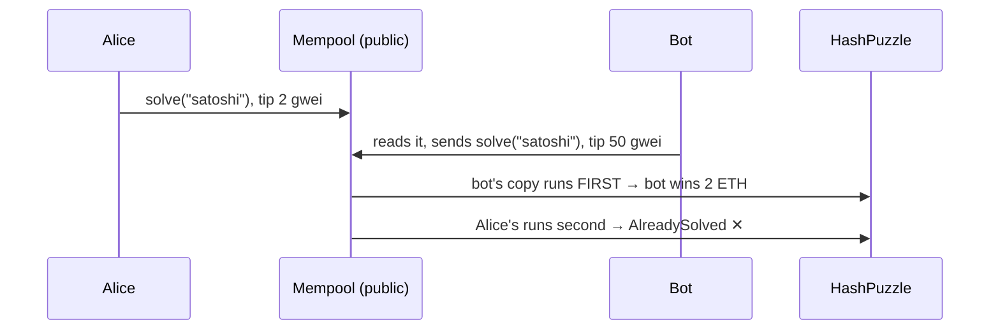

# Day 09 — Smart-contract security: break it, then fix it

> Days 06–08 each met one bug along the way (a re-entrant vault, a re-entrant mint). Today the bugs are the topic. I wrote **five small contracts that are broken on purpose**, a **working attack** for each one, and a **fixed version** that the same attack cannot beat. Every claim below is a test that passes on a local Hardhat chain.

## The idea in plain words

A smart contract is a vending machine that holds real money and that **anyone in the world can poke, in any order, as often as they like**. Once deployed, the code cannot be patched. So "it works when I use it" is not enough: it has to keep working when someone is actively trying to break it.

The five classic ways it goes wrong:

| # | Bug | Everyday picture | Fix |
|---|-----|------------------|-----|
| 1 | **Re-entrancy** | A cashier hands you cash *before* writing the withdrawal in the book. While holding the cash, you ask again, and the book still shows your old balance. | Write in the book first, then pay (*Checks → Effects → Interactions*), plus a lock: one customer at a time (`nonReentrant`). |
| 2 | **Missing access control** | The "make me the owner" button has no lock on it. | Set the owner once, in the constructor; `onlyOwner` on every admin function; hand over ownership in two steps. |
| 3 | **`tx.origin` authentication** | The bank checks *who started the errand*, not *who is at the counter*. A stranger you sent on a "free gift" errand can empty your account. | Check `msg.sender` (whoever is calling right now). |
| 4 | **Front-running** | You shout the quiz answer in a room full of people; someone faster repeats it and takes the prize. Waiting transactions (the **mempool**) are public, and higher fees go first. | **Commit–reveal**: first hand in a sealed envelope, open it a block later. |
| 5 | **Denial of service** | A shop that must hand the last customer a refund before serving anyone new. One customer refuses to take the refund, and the shop is stuck forever. | **Pull payments**: record what is owed; each person collects their own. |

```
 1. Re-entrancy (VulnerableBank)                         The fix (SafeBank)

 Thief ── withdraw() ──▶ Bank                            Thief ── withdraw() ──▶ Bank
                          │ send 1 ETH ─────┐                                      │ balance = 0      ← FIRST
          ◀── receive() ──┘                 │                                      │ send 1 ETH
 Thief ── withdraw() ──▶ Bank  (balance     │            Thief ── withdraw() ──▶ Bank 🔒 locked → refused
                          │ still 1 ETH!)   │ ×10
          ◀── receive() ──┘ ...             │
                          balance = 0  ◀────┘  (too late)
```



### Key terms

| Term | Plain meaning |
|---|---|
| **Exploit** | Code that uses a bug to do something the author did not intend (usually: take money) |
| **Re-entrancy** | A contract is called again before its first call has finished |
| **Checks-Effects-Interactions (CEI)** | Order inside a function: check inputs → update your own records → only then call others / send ETH |
| **`nonReentrant`** | OpenZeppelin's lock: a second entry while the first is running reverts |
| **`msg.sender` vs `tx.origin`** | `msg.sender` = whoever is calling right now (can be a contract). `tx.origin` = the person who signed the whole transaction |
| **Mempool** | The public waiting room of transactions not yet in a block |
| **Front-running** | Seeing someone's waiting transaction and getting yours in first by paying a higher fee |
| **Commit–reveal** | Send `hash(you, answer, secret salt)` first; send the answer later. The hash hides it and only works for you |
| **Push vs pull payment** | Push: the contract sends money as part of your action. Pull: it records the debt and you withdraw |
| **Invariant** | A rule that must be true after every single step (e.g. "ETH held = sum of all balances") |

## Code

Solidity compiles **offline** with solcjs (see [`tools/README.md`](../tools/README.md)). Everything runs on a **local** Hardhat chain: no real money, no testnet.

```bash
cd day-09
npm install
npm start               # guided tour: each attack on the broken contract, then on the fixed one
npm run node            # or: local node in one terminal …
npm run demo:localhost  # … and the tour against it in another
npm test                # 31 tests (about 8 s; FUZZ_RUNS=200 npm test for a longer fuzz)
npm run ex:easy         # / ex:medium / ex:challenge : the exercise solutions
npm run lint            # ESLint + Solhint
npm run slither         # static analysis (after: npx hardhat clean && npm run compile)
```

| Folder | What is inside |
|---|---|
| [`contracts/vulnerable/`](contracts/vulnerable) | **Deliberately broken**: `VulnerableBank`, `VulnerableWallet`, `TxOriginWallet`, `HashPuzzle`, `KingOfTheHill`. Never deploy these. |
| [`contracts/fixed/`](contracts/fixed) | The fixes: `SafeBank` (CEI + lock), `SafeWallet` (`Ownable2Step`), `MsgSenderWallet`, `CommitRevealPuzzle`, `SafeKingOfTheHill` (pull payments) |
| [`contracts/attackers/`](contracts/attackers) | Test-only attackers: `ReentrancyAttacker`, `CrossFunctionAttacker`, `PhishingAirdrop`, `StubbornKing`, `ForceFeeder`, `RefusingDepositor` |
| [`contracts/exercises/`](contracts/exercises) | Evening exercises: `PullAuction` (+ `StubbornBidder`) and `LeakyBank` (broken on purpose, for the fuzz challenge) |
| [`exercises/`](exercises) | 3 levels + runnable solutions |
| [`src/demo.js`](src/demo.js) | The guided tour (`npm start`) |
| [`test/`](test) | One file per bug (exploit ✔ on the broken one, attack ✕ on the fixed one), [`05-invariants`](test/05-invariants.test.js) fuzz tests with fast-check, [`06-audit`](test/06-audit.test.js) regression tests for the QA findings, and a small "mempool bot" in [`helpers.js`](test/helpers.js) |

How the front-running test works: Hardhat's **automine is switched off**, so transactions wait in a mempool like on a real network. The bot reads the pending block (`eth_getBlockByNumber("pending")`), decodes Alice's call, and sends the same call with a higher tip. Then one block is mined and we look at the order.

## Results from my run

`npm start` (Hardhat in-process chain):

```
1. Re-entrancy: paying out BEFORE updating the balance
   VulnerableBank thief deposits 1 ETH -> re-entries 10, refused 0, bank left with 0.0 ETH, thief profit 10.0 ETH
   SafeBank       thief deposits 1 ETH -> re-entries 1, refused 1, bank left with 10.0 ETH, thief profit 0.0 ETH
   Cost of safety: withdraw 28,479 gas (vulnerable) vs 32,303 gas (safe, +3,824 for the lock and an event)

2. Access control: an initialize() anyone can call
   VulnerableWallet: thief calls initialize(thief), owner is now thief: true; wallet left with 0.0 ETH
   SafeWallet: thief calls withdrawAll -> OwnableUnauthorizedAccount; wallet keeps 5.0 ETH

3. tx.origin: a fake 'claim your airdrop' button
   TxOriginWallet  Alice clicks claim() -> wallet emptied; wallet holds 0.0 ETH
   MsgSenderWallet Alice clicks claim() -> refused (NotOwner); wallet holds 5.0 ETH

4. Front-running: a bot copies your answer from the waiting room (mempool)
   Bot reads Alice's pending transaction: solve("satoshi") with a 2 gwei tip
   Bot resends it with a 50 gwei tip. In the block: bot at position 0 (WINS 2 ETH), Alice at position 1 (fails: AlreadySolved)
   Commit-reveal: Alice first sends a sealed envelope keccak256(her address, answer, salt)
   Next block she reveals. Bot copies it with a higher tip -> fails (NoCommitment); Alice wins the 2 ETH

5. Denial of service: one refund that always fails
   KingOfTheHill     Bob bids 3 ETH -> RefundFailed; Carol bids 10 ETH -> RefundFailed; king = the stubborn contract (forever)
   SafeKingOfTheHill Bob bids 3 ETH -> ok; Carol bids 10 ETH -> ok; king = Carol
```

Things that surprised me:
- **1 ETH stole 10 ETH.** The thief's deposit was only the key; the 10 ETH belonged to Alice and Bob. The bug is two lines in the wrong order.
- **Safety is cheap.** The lock and the event cost **3,824 extra gas** per withdraw, about 13%.
- **The bot sent its transaction *second* and ran *first*** (position 0 vs 1 in the same block). Order is bought, not earned.
- **Slither flagged only 2 of my 5 planted bugs with a real warning** (re-entrancy and `tx.origin`). The open `initialize()`, the front-running and the stuck refund were invisible to it. Tools help; the exploit tests are what prove it.
- **Two ways to block a re-entry, and my first test could not tell them apart** (see QA.md T1).

**Quality (after the evening audit):** 31 / 31 tests pass, including fuzz tests (200 random programs, 1,257 steps, the money invariant held after every one). ESLint + Solhint clean. `npm audit --omit=dev` 0 vulnerabilities. Slither: every result explained in [QA.md](QA.md). 1 Medium and 3 Low findings fixed in total (the evening one is E1 below).

## Evening update

The evening audit asked a new question of the *fixed* contracts: "where can money end up that nobody can ever move?" It found **E1 (Low)**: `SafeBank.transferBalance` accepted the bank's own address as the receiver. A balance parked there is lost, because a contract never calls its own `withdraw()`. One wrong address, no attacker needed. Now it reverts with `InvalidRecipient`. See [QA.md](QA.md#evening-audit).

Exercises ([`exercises/`](exercises)): build a commitment by hand and see why `abi.encode` (not packed) matters (easy), a **pull-payment auction** that a bidder who cannot receive ETH cannot block (medium), and a **fuzz challenge**: `LeakyBank` has one deleted line, and a property test "ETH held = sum of balances" finds the bug without being told where to look. In my run it broke `LeakyBank` in **2 steps** (Carol deposits 0.001 ETH, then sends it to Alice) and `SafeBank` survived 100 random programs.

### What I'd explore next

- **Read-only re-entrancy**: a view function that reads state in the middle of someone else's call. The lock on `withdraw` does not protect other contracts that trust `balanceOf`.
- **Private mempools and MEV protection (Flashbots)**: instead of hiding the answer with commit–reveal, hide the whole transaction from bots.
- **Formal verification / symbolic execution**: prove "no input breaks the invariant" instead of testing 1,257 random steps.

## Key takeaways

1. **Update your records before you send money.** Checks → Effects → Interactions, and a `nonReentrant` lock on everything that moves value.
2. **Every function is public to the whole world unless you lock it.** Look at each one and ask "what if a stranger calls this?"
3. **Never use `tx.origin` to decide who is allowed.** Use `msg.sender`.
4. **Your transaction is public before it is final.** If seeing it lets someone profit, hide it with commit–reveal (or don't put the secret on-chain at all).
5. **Don't let one receiver block everyone.** Record what is owed and let people pull it.
6. **Never trust `address(this).balance` as your bookkeeping.** ETH can be forced in. Keep your own records (QA I1).
7. **The broken contracts here are teaching material, not templates.** Do not put real funds in any of them.

## Manual QA checklist

- [x] Each bug has an exploit test that **succeeds** on the broken contract and **fails** on the fixed one
- [x] Re-entrancy: same-function and cross-function, with the lock's own error asserted
- [x] Access control: every admin function called by a stranger; two-step ownership; zero addresses; `renounceOwnership`
- [x] `tx.origin`: phishing contract, direct call
- [x] Front-running: copied answer, copied reveal, copied commitment, commit + reveal in the same block
- [x] DoS: refusing receiver; equal bid; self-outbid
- [x] Force-fed ETH (selfdestruct) does not break accounting
- [x] Fuzz invariants on `SafeBank` and `SafeKingOfTheHill`
- [x] Solhint + ESLint clean, `npm audit` clean, Slither reviewed

## References

- [Solidity docs: Security considerations](https://docs.soliditylang.org/en/v0.8.24/security-considerations.html) (re-entrancy, `tx.origin`, gas limits, pull-over-push)
- [SWC Registry](https://swcregistry.io/): SWC-107 Re-entrancy · SWC-105 Unprotected Ether withdrawal · SWC-115 `tx.origin` · SWC-114 Transaction order dependence · SWC-113 DoS with failed call
- [OpenZeppelin Contracts 5.x: Access control (Ownable, Ownable2Step)](https://docs.openzeppelin.com/contracts/5.x/access-control) · [Utilities (ReentrancyGuard)](https://docs.openzeppelin.com/contracts/5.x/api/utils)
- [ethereum.org: Smart contract security](https://ethereum.org/en/developers/docs/smart-contracts/security/) · [ethereum.org: MEV](https://ethereum.org/en/developers/docs/mev/)
- [Slither](https://github.com/crytic/slither) · [fast-check](https://fast-check.dev/)

## Coming next

**Day 10 — DeFi:** a constant-product exchange (x · y = k) from scratch, with fees, and invariant tests that prove the pool can never be drained by rounding.
