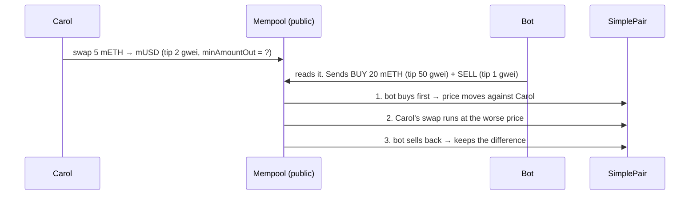

# Day 10 — DeFi: an exchange with no company behind it (x · y = k)

> Day 07 built tokens. Day 09 learned how contracts get attacked. Today both meet: a **swap pool** that trades two tokens with no order book, no company and no one in charge, just one line of maths. I wrote it from scratch (`SimplePair`), checked it against a JavaScript copy of the same maths to the last wei, attacked it with a **sandwich bot** and a **donation attack**, and let a fuzzer run hundreds of random trading sessions against four rules that must never break.

## The idea in plain words

Imagine a **jar with apples and oranges** on a table. Anyone may swap: put apples in, take oranges out. The only rule:

> **apples × oranges must not go down.**

If the jar has 100 apples and 100 oranges (100 × 100 = 10,000) and you add 25 apples, the jar now has 125 apples, so it can only give you oranges down to 10,000 ÷ 125 = 80. You get **20 oranges**, not 25. The more you take, the more each next orange costs. Nobody sets the price. The jar does.

That jar is an **AMM** (automated market maker). On Ethereum it is a contract holding two tokens:

| Term | Plain meaning |
|---|---|
| **AMM** | A contract that trades tokens using a formula instead of matching buyers and sellers |
| **Pool / reserves** | The two piles of tokens in the contract (`x` and `y`) |
| **x · y = k** | The constant-product rule: after a trade, `x × y` must be at least `k` |
| **Price** | The ratio of the piles. 100 mETH and 200,000 mUSD means 1 mETH ≈ 2,000 mUSD |
| **Price impact** | A big trade moves the ratio, so you get a worse average price |
| **Swap fee (0.30%)** | Every trade leaves 0.3% of what you put in inside the pool, which makes `k` grow |
| **Liquidity provider (LP)** | Someone who deposits both tokens so others can trade |
| **LP shares** | A receipt for your part of the pool. The fees make each share worth a bit more over time |
| **Slippage limit (`minAmountOut`)** | "Cancel my trade if I would get less than this" |
| **Sandwich attack** | A bot buys just **before** your trade (pushing the price up) and sells just **after** it, pocketing the difference you paid |

### The formula

With the 0.30% fee, selling `Δx` gives you

```
            Δx · 0.997 · y
   Δy  =  ─────────────────────
            x  +  Δx · 0.997
```

Rounded **down**, so every tiny rounding error stays in the pool. It is never paid to the trader.

```
   y (mUSD in the pool)
   │
   │●  start: 100 mETH, 200,000 mUSD
   │ ╲
   │  ╲      every trade slides along this curve
   │   ●──── after selling 25 mETH: 125 mETH, ~160,096 mUSD
   │     ╲__
   │        ‾‾──●─── after selling 50 more…
   │               ‾‾‾‾‾‾‾‾───────────  (never reaches 0)
   └──────────────────────────────────── x (mETH in the pool)
```

### A sandwich, step by step



The defence is one number: **`minAmountOut`**. If Carol says "at least 99.5% of today's quote", the bot can only squeeze her by 0.5%. Try for more, and her trade simply cancels.

## Code

Solidity compiles **offline** with solcjs (see [`tools/README.md`](../tools/README.md)). Everything runs on a **local** Hardhat chain with mock tokens: no real money, no testnet.

```bash
cd day-10
npm install
npm start               # guided tour: pool, price impact, fees, sandwich attack, donation attack
npm run node            # or: local node in one terminal …
npm run demo:localhost  # … and the tour against it in another
npm test                # 25 tests (~10 s; FUZZ_RUNS=500 npm test for a longer fuzz)
npm run lint            # ESLint + Solhint
npm run slither         # static analysis (after: npx hardhat clean && npm run compile)
```

| File | What is inside |
|---|---|
| [`contracts/SimplePair.sol`](contracts/SimplePair.sol) | The AMM: `addLiquidity`, `removeLiquidity`, `swap`, `getAmountOut`, `quote`. The pool is also the LP-share token (ERC-20) |
| [`contracts/test-helpers/`](contracts/test-helpers) | Test-only tokens: `MockToken` (anyone can mint), `FeeOnTransferToken` (burns 1% per transfer), `ReentrantToken` (calls back into the pool mid-transfer) |
| [`src/amm.js`](src/amm.js) | The same maths in JavaScript (BigInt). Tests use it as a reference: the contract must agree to the wei |
| [`src/sandwich.js`](src/sandwich.js) | A working sandwich bot: reads the victim's pending transaction from the mempool, picks the biggest front-run the victim's limit allows, sends buy + sell around it |
| [`src/demo.js`](src/demo.js) | The guided tour (`npm start`) |
| [`test/01-pair.test.js`](test/01-pair.test.js) | Liquidity, swaps, fees, price impact, input checks |
| [`test/02-attacks.test.js`](test/02-attacks.test.js) | Sandwich with and without a limit, donation/inflation attack, fee-on-transfer token, re-entrant token |
| [`test/03-invariants.test.js`](test/03-invariants.test.js) | fast-check fuzzing: random programs of add / swap / remove by 3 users, 4 rules checked after every step |
| [`test/04-audit.test.js`](test/04-audit.test.js) | Regression tests for the QA findings ([QA.md](QA.md)) |

Design choices that matter for safety (each one has a test):

1. **The pool keeps its own books** (`reserve0`, `reserve1`) and never prices from `balanceOf`. Tokens someone sends in directly cannot move the price or the share value.
2. **It counts what really arrived** (balance before and after), so a token that takes a fee in transit cannot make the pool count money it never got.
3. **1,000 shares are locked forever** on the first deposit, so the price of one share can never be pushed to an absurd value.
4. **Every function has a slippage limit and a deadline.**
5. **A re-entrancy lock** on every function that changes state (Day 06/09), and outputs can't be sent to the zero address, the pool or a token contract.

## Results from my run

`npm start` (Hardhat in-process chain; `npm run demo:localhost` printed the same):

```
1. A pool: Alice deposits 100 mETH + 200,000 mUSD  (price: 1 mETH = 2,000 mUSD)
   Alice receives 4,472.14 LP shares (sqrt(100 x 200,000) minus 1,000 wei locked forever)

2. Price impact: the bigger the trade, the worse the price
   sell mETH   get mUSD      avg price    impact
        1     1,974.32    1,974.32     1.28%
        5     9,496.59    1,899.32     5.03%
       10    18,132.22    1,813.22     9.34%
       25    39,903.94    1,596.16    20.19%
       50    66,533.20    1,330.66    33.47%

3. Fees stay in the pool: Bob trades 5 mETH back and forth 10 times
   reserves now 100.2854 mETH + 200,000.00 mUSD; k grew by 0.29%
   Alice withdraws: 100.2854 mETH + 200,000.00 mUSD (she put in 100 + 200,000)

4. Sandwich attack on Carol's swap of 5 mETH (bot budget 20 mETH)
   Fair output with nobody in the way: 9,496.59 mUSD
   No slippage limit : Carol gets 6,650.79 mUSD (loses 2,845.80, 29.97%); bot profit 1.4426 mETH
   0.5% slippage limit: Carol gets 9,449.11 mUSD (loses 47.48, 0.50%); bot profit 0.0245 mETH

5. Donation attack: tokens sent straight to the pool are ignored
   Attacker donated 1,000 + 1,000. Carol deposits 10 + 10 and withdraws 10.000000 mETH back. Attack failed.

   (gas for one swap: 78,574)
```

Things that surprised me:
- **Selling 1 mETH already costs 1.28%** in a pool of 100 (0.30% fee + 0.98% price impact). At 50 mETH, a third of the value is gone. Pool size is everything.
- **Fees are the LP's income.** Bob's 10 round trips cost him 0.2854 mETH (about 570 mUSD), and all of it landed in Alice's share. She withdrew more than she put in without doing anything.
- **No slippage limit = 30% gone.** The bot spent nothing but gas and kept 1.44 mETH (about 2,900 mUSD). With a 0.5% limit, the same bot could take only 0.0245 mETH. One parameter, 60× less damage.
- **Hardhat let me run a real sandwich**: automine off, the bot reads `eth_getBlockByNumber("pending")`, and the block came out exactly front-run → victim → back-run, ordered by tip.
- **The fuzzer found my test was wrong, not the contract**: my first run reported reverts as "unrecognized custom error" and failed. I had to decode errors with the pool's ABI before the fuzzer could tell expected reverts from real bugs.

**Quality:** 25 / 25 tests pass. Fuzz: 150 random programs, 946 steps in my final run (it changes every run), all four rules held after every step, plus 2,000 random "buy then sell back" checks that never made a profit. ESLint + Solhint clean. `npm audit --omit=dev`: 0 vulnerabilities. Slither: every result explained in [QA.md](QA.md). 2 Low findings fixed: L1 in the contract, T1 in my own fuzz test.

## Key takeaways

1. **An AMM is one rule: `x × y` must not go down.** The price is just the ratio of the two piles.
2. **Big trades in small pools are expensive.** Price impact grows fast; check it before you swap.
3. **Fees are what pay liquidity providers.** They stay in the pool and make every share worth more.
4. **Always set a slippage limit.** Your pending trade is public; without `minAmountOut`, a bot decides your price.
5. **Never price from `balanceOf`.** Keep your own books, and count what actually arrived.
6. **Round against the user, in favour of the pool.** Tiny rounding, repeated by bots millions of times, is a real attack.
7. **This is a teaching contract, not Uniswap.** It has no price oracle, no flash swaps and no audit. Don't put real funds in it.

## Manual QA checklist

- [x] Swap output equals the JS model to the wei; `k` never decreases on a swap
- [x] Value per LP share never decreases (fuzzed), books always equal real balances (fuzzed)
- [x] Round trip (buy then sell) never profits (2,000 random cases)
- [x] Sandwich: unprotected victim loses; 0.5% limit caps the loss at 0.5%; greedy front-run makes the victim revert
- [x] Add-liquidity sandwich caught by `minShares`
- [x] Donation / first-depositor inflation attack fails
- [x] Fee-on-transfer token: books still match reality
- [x] Re-entrant token: blocked by the lock; read-only re-entrancy sees a consistent state
- [x] Zero amounts, unknown tokens, bad recipients, expired deadlines, empty pool
- [x] ESLint + Solhint clean, `npm audit` clean, Slither reviewed

## References

- [Uniswap V2 whitepaper](https://docs.uniswap.org/whitepaper.pdf) (constant product, fees, `MINIMUM_LIQUIDITY`, why reserves are tracked separately)
- [Uniswap V2 docs: How Uniswap works](https://docs.uniswap.org/contracts/v2/concepts/protocol-overview/how-uniswap-works) · [Pair contract](https://github.com/Uniswap/v2-core/blob/master/contracts/UniswapV2Pair.sol)
- [ethereum.org: Decentralized finance (DeFi)](https://ethereum.org/en/defi/) · [ethereum.org: MEV](https://ethereum.org/en/developers/docs/mev/)
- [OpenZeppelin Contracts 5.x: ERC-20, SafeERC20, ReentrancyGuard, Math](https://docs.openzeppelin.com/contracts/5.x/)
- [fast-check](https://fast-check.dev/) · [Slither](https://github.com/crytic/slither)

## Coming next

**Day 11 — Gas optimisation & upgradeable contracts:** the same kind of contract, cheaper. Packing storage (`uint112` reserves like Uniswap), custom errors, `immutable`, real gas reports, and a UUPS proxy so a contract can be upgraded safely.
