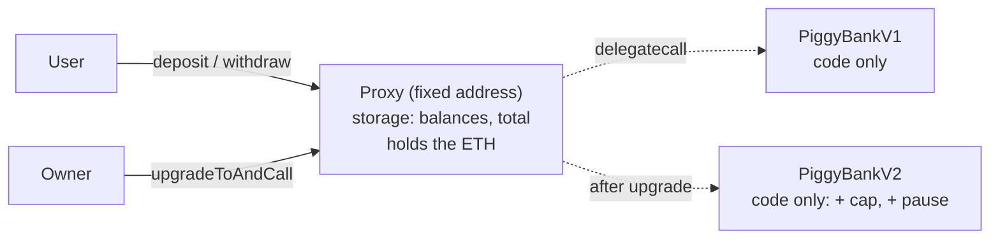

# Day 11 — Gas optimisation & upgradeable contracts

> Day 10 ended with a note: "pack the reserves and measure the gas". Today is that day. I wrote the **same contract twice**, once the obvious way and once the careful way, proved with a differential fuzzer that both behave **identically**, and measured every transaction from real receipts: the careful version is up to **70% cheaper**. Then the second half of the day: a contract that can be **upgraded** without changing its address or losing a single balance (a UUPS proxy), and the classic upgrade mistake that silently scrambles everyone's money.

## Part A — Gas: why the same job can cost 3× more

### The idea in plain words

Every step a contract takes costs **gas**, paid in ETH by the user. Most steps are cheap (an addition costs 3 gas). One kind is very expensive: **writing to storage**, the contract's permanent hard disk.

Storage is a long row of **32-byte boxes** ("slots"). Think of a **post office with lockers**: each locker you open costs money, whether you put in a letter or a parcel. Turning an empty box into a full one costs **20,000 gas**; changing a box that already holds something costs **2,900** (plus 2,100 the first time the box is touched in a transaction). Reading a box for the first time in a transaction costs **2,100**.

So the biggest trick is simple: **use fewer boxes.**

| Trick | What it means | Why it saves gas |
|---|---|---|
| **Storage packing** | Put small values side by side in one 32-byte slot (`address` 20 B + `uint64` 8 B + `uint32` 4 B = 32 B) | One box to open/write instead of four. And the box is already non-zero, so later writes cost 2,900, not 20,000 |
| **`immutable` / `constant`** | Values set once are baked into the contract's code | Reading costs ~3 gas instead of 2,100 |
| **Custom errors** | `revert NotOwner()` instead of `require(..., "a long message")` | 4 bytes instead of a stored string; smaller contract, cheaper failures, and errors can carry data |
| **`calldata` for inputs** | Read an array where it already is | No copy into memory |
| **Cache in local variables** | Read `list.length` / a storage value once | Memory/stack reads are ~3 gas; storage reads are 100–2,100 |
| **One storage write per batch** | Add up in a local variable, write the total once | 1 write instead of N |
| **`unchecked { ++i; }`** | Skip the overflow check where overflow is impossible | ~30–60 gas per loop round |

```
ClubNaive.Member — 4 slots per member           ClubOptimized.Member — 1 slot per member
┌────────────────────────────────┐              ┌────────────────────┬────────┬────┐
│ bool active        (1 B + 31 ∅)│ slot n       │ address referrer   │ uint64 │u32 │ slot n
├────────────────────────────────┤              │ (20 B)             │joinedAt│pts │
│ uint256 joinedAt          (32 B)│ slot n+1     └────────────────────┴────────┴────┘
├────────────────────────────────┤                 20 B + 8 B + 4 B = 32 B, nothing wasted
│ uint256 points            (32 B)│ slot n+2
├────────────────────────────────┤
│ address referrer   (20 B + 12 ∅)│ slot n+3
└────────────────────────────────┘
```

The price of packing: `points` is now a `uint32`, so it **must** be range-checked. `ClubOptimized` reverts with `PointsOverflow` instead of silently wrapping (test: *caps points at uint32 instead of silently wrapping*). Packing that loses data is a bug, not an optimisation.

## Part B — Upgradeable contracts (UUPS proxy)

### The idea in plain words

A deployed contract's code can **never** change. That is the point of a blockchain, and a problem when you find a bug. The workaround is a **proxy**:

- The **proxy** is like a **shop front with a fixed address**. It holds the money and the records (storage).
- The **implementation** is the **staff working inside**. It holds only the code.
- The proxy forwards every call to the implementation with `delegatecall`: "run your code, but on **my** storage and **my** balance".
- To upgrade, the owner points the proxy at **new staff** (a new implementation). Same address, same money, new rules.



| Term | Plain meaning |
|---|---|
| **delegatecall** | "Borrow" another contract's code and run it on your own storage |
| **ERC-1967 slot** | A fixed, random-looking storage slot where the proxy keeps the implementation address, so it never collides with your variables |
| **UUPS** (ERC-1822) | The upgrade function lives in the **implementation**, not the proxy. Smaller, cheaper proxy; but every new version must keep the upgrade function, or the proxy is frozen forever |
| **initialize()** | Proxies never run constructors, so setup goes in a function that can run **once** |
| **`_disableInitializers()`** | Locks the bare implementation so nobody can "initialize" it and claim it |
| **Storage layout** | The order of state variables = which slot holds what. **Only ever append** in a new version |

### The classic mistake

V1 stores `balanceOf` in slot 0 and `totalDeposits` in slot 1. A "V2" that declares them in the other order compiles fine and upgrades fine, and then every balance reads **0** while the 5 ETH sit in the contract. The test *forced anyway, every balance reads from the wrong slot* proves it, and *hardhat-upgrades refuses the broken V2* shows the tool that catches it before deployment.

## Code

Solidity compiles **offline** with solcjs (see [`tools/README.md`](../tools/README.md)), plus `@openzeppelin/contracts-upgradeable` and `@openzeppelin/hardhat-upgrades` for the proxy and its storage-layout checks. Everything runs on a **local** Hardhat chain.

```bash
cd day-11
npm install
npm start               # guided tour: gas report + UUPS upgrade V1 -> V2
npm run gas             # just the gas report
npm test                # 31 tests (~4 s; FUZZ_RUNS=200 npm test for a longer differential fuzz)
npm run lint            # ESLint + Solhint
npm run slither         # static analysis (after: npx hardhat clean && npm run compile)
```

| File | What is inside |
|---|---|
| [`contracts/gas/ClubNaive.sol`](contracts/gas/ClubNaive.sol) | A members club (join fee, referral points, owner batch rewards) written the obvious way. Every waste marked `GAS:` |
| [`contracts/gas/ClubOptimized.sol`](contracts/gas/ClubOptimized.sol) | Same club, same behaviour, 8 savings marked `SAVE 1…8` |
| [`contracts/upgrade/PiggyBankV1.sol`](contracts/upgrade/PiggyBankV1.sol) | ETH savings box behind a UUPS proxy: initializer, locked implementation, two-step owner, re-entrancy lock |
| [`contracts/upgrade/PiggyBankV2.sol`](contracts/upgrade/PiggyBankV2.sol) | The upgrade: per-user cap + emergency pause, appended storage, `reinitializer(2)` |
| [`contracts/upgrade/test-helpers/`](contracts/upgrade/test-helpers) | Test-only: `PiggyBankV2Broken` (reordered storage), `NotUpgradeable` (would brick the proxy), `Reenterer` (re-entrancy attacker) |
| [`src/gas.js`](src/gas.js) · [`src/gas-report.js`](src/gas-report.js) | Runs the same scenario on both clubs and reads `gasUsed` from every receipt |
| [`src/demo.js`](src/demo.js) | The guided tour (`npm start`) |
| [`test/01-gas-club.test.js`](test/01-gas-club.test.js) | Behaviour tests for both clubs, custom-error tests, **differential fuzz** (fast-check), gas assertions |
| [`test/02-upgrade.test.js`](test/02-upgrade.test.js) | Proxy deploy, upgrade keeps state, access control, locked implementation, brick protection, reordered-storage disaster |
| [`test/03-audit.test.js`](test/03-audit.test.js) | Regression tests for the QA findings ([QA.md](QA.md)) |

## Results from my run

`npm start` (Hardhat in-process chain, optimizer on, 200 runs):

```
A. Gas optimisation
action                              naive  optimized      saved   %
deploy                            613,601    540,032     73,569   12.0%
join (no referrer)                 96,580     67,939     28,641   29.7%
join (with referrer)              146,331     78,825     67,506   46.1%
addPointsBatch (10 members)       299,741    103,494    196,247   65.5%
addPointsBatch (50 members)     1,382,563    408,594    973,969   70.4%
addPointsBatch again (50)         527,563    408,594    118,969   22.6%
withdraw                           30,843     28,743      2,100    6.8%
bytecode size (bytes)               2,383      2,253        130    5.5%

B. Upgradeable contract (UUPS proxy)
   1. Deployed PiggyBank V1 behind proxy 0x8A93d247134d91e0de6f96547cB0204e5BE8e5D8
      logic (implementation) lives at   0xb9bEECD1A582768711dE1EE7B0A1d582D9d72a6C
   2. Alice saves 3 ETH, Bob saves 2 ETH -> total 5.0 ETH, version 1.0.0
   3. Eve tries to upgrade -> reverted (OwnableUnauthorizedAccount)
   4. A V2 with reordered variables is rejected by the storage check:
      "New storage layout is incompatible" (balanceOf moved from slot 0 to slot 1)
   5. Owner upgrades to V2 (cap 5 ETH per user, emergency pause)
      same address 0x8A93d247134d91e0de6f96547cB0204e5BE8e5D8, new logic at 0x40918Ba7f132E0aCba2CE4de4c4baF9BD2D7D849
      Alice still has 3.0 ETH, Bob 2.0 ETH, version 2.0.0
   6. Alice tries to add 3 ETH -> CapExceeded(6.0 > 5.0)
   7. Owner pauses deposits; Alice can still withdraw her 3 ETH. Box now holds 2.0 ETH
```

(The batch rows change by a few gas between runs: the members are random addresses, and calldata zero-bytes are cheaper than non-zero bytes.)

Things that surprised me:
- **Packing is where the big money is.** Rewarding 50 brand-new members: 1,382,563 → 408,594 gas (−70%). Most of that is one fact: in the naive club each member's `points` box starts **empty** (20,000 gas to fill), while in the packed club it shares a box that `join` already filled (2,900 gas).
- **Without packing, the other tricks still save 22.6%.** The "again" row rewards the same 50 members a second time, so every box is already non-zero in **both** versions. What's left is the effect of calldata, cached length, `unchecked`, one total write and immutables.
- **Immutables are free money.** `withdraw` saves exactly **2,100 gas**: one cold storage read of `owner`, gone.
- **Custom errors made the contract smaller *and* more useful.** 130 fewer bytes, and `WrongFee(1, 10000000000000000)` tells the user what went wrong.
- **An upgrade really is just one storage slot.** The ERC-1967 slot changed from `0xb9bE…` to `0x4091…`; the address, the balances and the ETH didn't move.
- **The storage-layout checker is not optional.** The reordered V2 compiled cleanly and Solidity said nothing. Only the plugin noticed.

**Quality:** 31 / 31 tests pass. Differential fuzz: 40 random programs (211 steps in my final run; it changes every run) gave identical results on both clubs. ESLint + Solhint clean. `npm audit --omit=dev`: 0 vulnerabilities. Slither: 10 results, all explained in [QA.md](QA.md) (3 of them point at the naive club's wastes, which are there on purpose). 1 Low finding fixed (two-step ownership).

## Key takeaways

1. **Storage is the expensive part.** Fewer slots, and fewer empty → full writes, beat every micro-trick.
2. **Pack small types together, then range-check them.** A `uint32` that silently wraps is a bug.
3. **`immutable`, custom errors, `calldata`, cached reads**: small, safe wins. Use them by default.
4. **Measure, don't guess.** Real receipts on a local chain, same scenario, same results, two versions.
5. **A proxy splits money (storage) from rules (code).** Upgrading changes the rules, never the address.
6. **Upgradeable code has its own rules:** no constructors (use `initialize`), lock the implementation, only append variables, protect `_authorizeUpgrade`.
7. **An upgradeable contract is only as trustworthy as its owner.** The owner can replace the code. In production that key belongs to a multisig behind a timelock.

## Manual QA checklist

- [x] Naive and optimized clubs agree on every success/failure and every balance (differential fuzz)
- [x] Optimized is strictly cheaper on every measured action (asserted in tests)
- [x] Packed `uint32` points can't overflow silently
- [x] Initializer runs once; both implementations are locked
- [x] Only the owner can upgrade; ownership transfer is two-step
- [x] Upgrade keeps the address, balances and ETH; `initializeV2` runs once, owner only
- [x] Upgrade to a non-UUPS contract is refused (no bricking); direct calls to the implementation refused
- [x] Reordered storage is caught by the plugin; forced anyway, the damage is demonstrated
- [x] Re-entrancy on withdraw blocked; withdrawals work while paused and above a lowered cap
- [x] ESLint + Solhint clean, `npm audit` clean, Slither reviewed

## References

- [Solidity docs: Layout of state variables in storage](https://docs.soliditylang.org/en/v0.8.24/internals/layout_in_storage.html)
- [EIP-2929: gas cost increases for state access opcodes (cold/warm)](https://eips.ethereum.org/EIPS/eip-2929) · [evm.codes: SSTORE / SLOAD costs](https://www.evm.codes/)
- [Solidity blog: Custom errors](https://soliditylang.org/blog/2021/04/21/custom-errors/)
- [EIP-1967: proxy storage slots](https://eips.ethereum.org/EIPS/eip-1967) · [EIP-1822: UUPS](https://eips.ethereum.org/EIPS/eip-1822)
- [OpenZeppelin: Proxy upgrade pattern](https://docs.openzeppelin.com/upgrades-plugins/proxies) · [Writing upgradeable contracts](https://docs.openzeppelin.com/upgrades-plugins/writing-upgradeable)
- [OpenZeppelin Contracts 5.x: UUPSUpgradeable](https://docs.openzeppelin.com/contracts/5.x/api/proxy#UUPSUpgradeable)

## Coming next

**Day 12 — Oracles, Layer 2 & bridges:** how a contract learns the price of ETH without trusting one website (a mock Chainlink-style feed with staleness checks), how rollups make transactions cheaper, and why bridges are where the biggest hacks happen.
