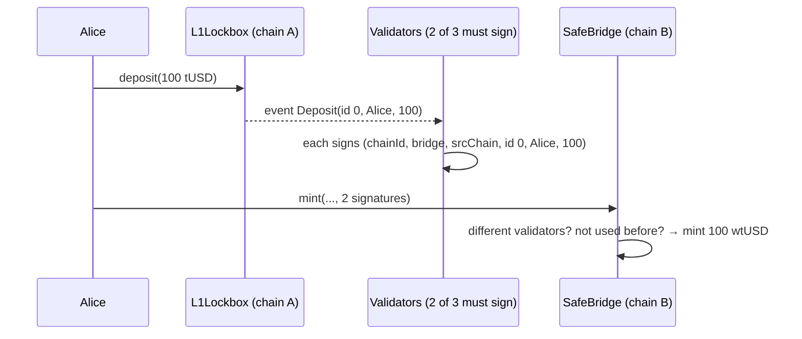

# Day 12 — Oracles, Layer 2 rollups & bridges

> Day 10's AMM and Day 11's piggy bank only knew what was **inside** the blockchain. Real apps need outside facts ("what is 1 ETH worth in dollars?"), cheaper transactions, and a way to move tokens between chains. Today covers all three, and each one adds a new thing you have to **trust**. I built a price reader that refuses 6 kinds of bad price, a tiny rollup whose fraud proof finds **1 lie in 1,000 transactions in 10 steps**, and two bridges: one safe, and one where **2 signatures minted 500 tokens for a 100-token deposit**.

## Part A — Oracles: getting outside facts onto the chain

### The idea in plain words

A smart contract can't open a website. It only sees what is already on the chain. An **oracle** is a service that **writes outside facts onto the chain**, for example the ETH/USD price.

Think of it like a **weather board at a train station**: the station doesn't measure the weather itself, someone posts it. If that board shows yesterday's weather, or "-1 °C" in summer by mistake, you dress wrong. A lending app that reads a wrong ETH price lends too much money, or **liquidates** (force-sells) people who were fine.

Chainlink's answer: many independent node operators each report a price, and the feed publishes the **median**. It updates when the price moves more than a set % (the **deviation threshold**) or after a fixed time (the **heartbeat**), whichever comes first. The feed is still only as good as your code that reads it.

### The six checks my `SafePriceReader` does

```mermaid
flowchart TD
    A[price requested] --> S{On an L2:<br/>sequencer up?}
    S -- down --> X1[revert SequencerDown]
    S -- up --> G{up longer than<br/>the grace period?}
    G -- no --> X2[revert GracePeriodNotOver]
    G -- yes --> P{answer > 0?}
    P -- no --> X3[revert InvalidPrice]
    P -- yes --> T{0 < updatedAt ≤ now?}
    T -- no --> X4[revert InvalidTimestamp]
    T -- yes --> H{age ≤ heartbeat?}
    H -- no --> X5[revert StalePrice]
    H -- yes --> B{min ≤ answer ≤ max?}
    B -- no --> X6[revert PriceOutOfBounds]
    B -- yes --> OK[return price × 10^(18 − decimals)]
```

| Check | What it catches | Everyday comparison |
|---|---|---|
| Sequencer up | On an L2, if the sequencer (the computer that orders L2 transactions) is down, the feed freezes and only some users can still act | The station clock stopped: don't trust the board |
| Grace period | Right after a restart, everyone's position gets re-priced at once; give people time to top up before liquidations | Let people off the train before boarding starts |
| `answer > 0` | A broken feed reporting 0 or a negative number (negative → `uint256` = a gigantic number) | A thermometer showing -273 °C |
| Timestamp sane | A round that was never filled (`updatedAt = 0`) or is "from the future" | A newspaper dated tomorrow |
| Heartbeat | The price stopped updating | Yesterday's newspaper |
| Min/max band | A glitch like $1,000,000 per ETH | A taxi meter saying $9,000 for 2 km |

Every failure **reverts** ("fail closed"): no price is better than a wrong price. The cost: the protocol pauses while the feed is broken, so production systems add a fallback feed or a manual circuit breaker.

## Part B — Layer 2 rollups: many transactions, one L1 entry

### The idea in plain words

Ethereum (Layer 1) is safe but expensive, because thousands of computers re-run every transaction. A **rollup** (Layer 2) runs transactions **off-chain**, then posts them to L1 **in a batch**, with a claimed result (the **state root**, a fingerprint of all balances, Day 01/04).

Like a **bus instead of 100 taxis**: the road toll (the fixed cost of one L1 transaction) is shared by everyone on board.

But who checks the result? Two answers:

| | Optimistic rollup (Optimism, Arbitrum, Base) | ZK rollup (zkSync, Starknet, Scroll) |
|---|---|---|
| Default | Result **assumed correct** | Result comes with a **validity proof** (math that it's correct) |
| Catching a lie | Anyone can submit a **fraud proof** during a challenge window (~7 days) | A wrong result can't get a valid proof |
| Withdraw to L1 | ~7 days (wait for the window) | As soon as the proof is verified |
| Covered | **Today** (simulated in JS) | Day 14 (zero-knowledge basics) |

### How a fraud proof finds one lie in 1,000 transactions

L1 can't re-run all 1,000 transactions (too expensive). Instead, the watcher and the sequencer play **"guess the page"**: they compare their state root after transaction 500. Same? The lie is in 501–1,000. Different? It's in 1–500. Halve again and again (**bisection**). After ⌈log₂ 1000⌉ = **10 rounds**, one transaction is left, and L1 re-runs **just that one** to see who lied.

```
txs:   0 ─────────────────────────────── 1000      sequencer and watcher disagree at the end
round 1:  [0 ──────── 500] [500 ──────── 1000]     agree at 500 → lie is on the right
round 2:                   [500 ── 750] ...        disagree at 750 → lie is on the left
  ...
round 10:                     [637 → 638]          L1 runs tx #637 itself → sequencer lied
```

The cheating sequencer loses its **bond** (a deposit it locked up front); half goes to the watcher, the rest is burned (so the sequencer can't "catch itself" for profit). Only **one honest watcher** is needed.

## Part C — Bridges: moving tokens between chains

A token can't literally leave its chain. A **lock-and-mint bridge** locks the real token on chain A and mints an **IOU** ("wrapped" token) on chain B. Like a **coat check**: you hand over your coat (lock), you get a ticket (wrapped token). The ticket is only worth something if the coat is still there and nobody prints extra tickets.



Bridges hold everyone's locked coats in one place, so they are the biggest targets in crypto: Ronin (2022, ~$600M; 5 of 9 validator keys stolen), Wormhole (2022, ~$320M; signature verification bypassed), Nomad (2022, ~$190M; any message accepted after an upgrade).

| Bug | `NaiveBridge` | `SafeBridge` |
|---|---|---|
| **Replay**: reuse the same signatures | Signs only (to, amount): reusable forever | Signs a **deposit id**, marks it **processed** |
| **One signer counted twice** | Counts signatures | Counts **different** signers (sorted, strictly increasing) |
| **Cross-chain / cross-bridge replay** | Nothing binds the chain | Digest includes `block.chainid` + bridge address |
| **Tampering** (change recipient/amount) | Covered (signed) | Covered (signed) |
| **Weak validator set** | Any threshold | Majority required, no duplicates, no zero address |
| **Stolen keys (≥ threshold)** | Lost | **Also lost.** That's the trust assumption; no code fixes it |

## Code

Solidity compiles **offline** with solcjs (see [`tools/README.md`](../tools/README.md)). Everything runs on a **local** Hardhat chain; the rollup is plain Node.js.

```bash
cd day-12
npm install
npm start          # oracle + bridge tour on a local chain
npm run rollup     # rollup cost table + fraud proof + 7-day window
npm test           # 56 tests (unit, attack, fuzz, exercises)
npm run ex         # only the 3 evening exercises
npm run lint       # ESLint + Solhint
npm run slither    # static analysis (after npm run compile)
```

| File | What it is |
|---|---|
| [`contracts/oracle/MockV3Aggregator.sol`](contracts/oracle/MockV3Aggregator.sol) | Local Chainlink-style feed (same `latestRoundData()` interface); also used as the L2 sequencer-uptime feed |
| [`contracts/oracle/NaivePriceReader.sol`](contracts/oracle/NaivePriceReader.sol) | The "before": trusts any answer |
| [`contracts/oracle/SafePriceReader.sol`](contracts/oracle/SafePriceReader.sol) | Six checks, decimals scaled to 18, fails closed |
| [`contracts/bridge/L1Lockbox.sol`](contracts/bridge/L1Lockbox.sol) | Locks tokens, emits `Deposit(id, from, to, amount)`, handles fee-on-transfer tokens |
| [`contracts/bridge/SafeBridge.sol`](contracts/bridge/SafeBridge.sol) / [`WrappedToken.sol`](contracts/bridge/WrappedToken.sol) | M-of-N signed minting with replay protection |
| [`contracts/bridge/NaiveBridge.sol`](contracts/bridge/NaiveBridge.sol) | The "before": three classic bridge bugs |
| [`src/rollup.js`](src/rollup.js) | Optimistic rollup simulation: state roots, batches, L1 gas model, bisection fraud proof, challenge window |
| [`src/demo.js`](src/demo.js), [`src/rollup-demo.js`](src/rollup-demo.js), [`src/deploy.js`](src/deploy.js) | Demos and shared deploy/sign helpers |
| [`test/`](test) | 01 oracle · 02 bridge · 03 rollup · 04 QA findings · 05 evening audit · 06 exercises |
| [`exercises/`](exercises) | Evening exercises and tested solutions (`npm run ex1`, `ex2`, `ex3`) |

**Rollup simplifications** (stated, not hidden): signatures are placeholder bytes (real ones on Day 03); the gas model counts L1 calldata only, before EIP-4844 blobs and without compression (real rollups today are cheaper still); the one-step proof recomputes the root from the full account list instead of a Merkle proof of the touched accounts (Day 04).

## Results from my run

`npm start`:

```
=== Part A — Oracles: what is 1 ETH worth? ===

  1. fresh price $2,000                  naive: $2,000                                 safe: $2,000
  2. feed silent for 2 hours             naive: $2,000                                 safe: REFUSED: StalePrice(7204, 3600)
  3. feed reports 0                      naive: $0                                     safe: REFUSED: InvalidPrice(0)
  4. feed reports -1                     naive: CRASH: overflow (uint256(-1) is huge)  safe: REFUSED: InvalidPrice(-1)
  5. feed reports $1,000,000 (glitch)    naive: $1,000,000                             safe: REFUSED: PriceOutOfBounds(100000000000000)
  6. L2 sequencer down                   naive: $1,800                                 safe: REFUSED: SequencerDown()
  7. sequencer back 1 min ago            naive: $1,800                                 safe: REFUSED: GracePeriodNotOver(3537)
  8. grace period over, fresh $1,800     naive: $1,800                                 safe: $1,800

=== Part B — A lock-and-mint bridge with 2-of-3 validators ===

  Alice locks 100.0 tUSD on "L1" → deposit #0
  2 of 3 validators sign → SafeBridge mints 100.0 wtUSD
  Replay the same signatures       → SafeBridge: AlreadyProcessed
  NaiveBridge, same 2 sigs sent 5x → 500.0 nwtUSD minted for a 100 tUSD lock
  NaiveBridge, ONE validator signs twice → attacker mints 1000000.0 nwtUSD

  Locked on L1: 100.0 tUSD · backed wtUSD: 100.0 · unbacked nwtUSD: 1000500.0
```

`npm run rollup`:

```
=== 1. What one transfer costs on L1 when it rides in a rollup batch ===
(plain L1 transfer = 21,000 gas; each rollup tx = 81 bytes of calldata)

  txs in batch | batch gas on L1 | gas per tx | vs L1 transfer
             1 |          47,128 |     47,128 | 2.2x MORE expensive
            10 |          57,376 |      5,738 | 3.7x cheaper
           100 |         159,700 |      1,597 | 13.1x cheaper
          1000 |       1,182,628 |      1,183 | 17.8x cheaper

=== 2. A cheating sequencer vs one honest watcher ===
Sequencer posts 1,000 txs. Secretly, after tx #637 it gave itself 1,000,000 coins.
Claimed final root: 9419361b9fc90451…   honest root: 58a59010e176e2b5…
Challenge on day 2 → fraud proven: true, bad tx found: #637, bisection rounds: 10
L1 re-executed just ONE transaction. Batch status: reverted.
Sequencer bond: 0 ETH (slashed) · watcher reward: 5 ETH

=== 3. Why withdrawals from an optimistic rollup take 7 days ===
  day 1: ChallengeWindowOpen — anyone may still prove fraud
  day 6: ChallengeWindowOpen — anyone may still prove fraud
  day 7: final ✔ (withdrawals can now be paid on L1)
```

Things that surprised me:
- **The naive reader didn't fail loudly; it quietly gave wrong answers.** 2 hours stale, $0, $1,000,000: it said "sure" every time. The only time it noticed anything was -1, and then it **crashed** (`uint256(-1)` overflows), which would freeze a whole lending app.
- **A batch of one is worse than no rollup.** Posting a single transaction costs **47,128 gas**, 2.2x an L1 transfer. The fixed cost only pays off when shared: **17.8x cheaper** at 1,000 transactions.
- **Bisection is shockingly efficient.** L1 checked 1 transaction out of 1,000, after 10 rounds of "same or different?". The fuzz test checks this for any batch size (1 to 300) and any lie position.
- **The 7-day withdrawal wait is not a bug, it's the security.** It's the time anyone has to prove fraud.
- **The bridge bug isn't in the crypto.** ECDSA worked perfectly in `NaiveBridge`. The bug was **what** got signed (no deposit id, no chain) and **how** signers were counted.

**Quality:** 56 / 56 tests pass (47 morning + 6 evening-audit + 3 exercises), including 3 fuzz properties (price checks, bridge supply ≤ locked, bisection always finds the lie). ESLint + Solhint clean. `npm audit --omit=dev`: 0 vulnerabilities. Slither: 9 results, all informational and explained in [QA.md](QA.md). 3 Low findings fixed during QA.

## Evening update

A second, independent review found **one real mistake** in the day's code, fixed with a failing test first:

- **E1 — a bond that could be negative or text.** The rollup simulation's `depositBond` took any value. `-5` quietly *shrank* a sequencer's bond, `NaN` and `1.5` broke the maths, and the text `"5"` became `"05"` (JavaScript glued it on instead of adding) and still counted as "more than zero". The bond is the sequencer's stake, so garbage in meant a fraud proof that pays nonsense. Now it must be a positive whole number, or `BadBond`.

The other five probes found nothing: a validator can't be counted twice even by re-encoding their signature, the price band and grace period are exact at the edges, a Merkle trick that fooled Bitcoin doesn't work here (every leaf includes its position), and the challenge window closes to the second.

**One improvement to the morning code:** `breakEvenBatchSize()` in `src/rollup.js` answers "how many transactions must share a batch before it beats a plain L1 transfer?" It's **3** (a batch of 2 still costs 24,134 gas per transaction, more than 21,000).

Exercises (3, with tested solutions): [`exercises/`](exercises). Full findings: [QA.md](QA.md#evening-audit). Study guide: [`notes.pdf`](notes.pdf).

### What I'd explore next
- Add the missing half of the bridge: burn the wrapped token and release the locked one (with the same replay protection).
- Give the rollup challenge a **time limit per move**, so a sequencer that stops answering loses (known issue K5).
- Replace the fixed validator set with a rotation controlled by a timelock, and add an emergency pause.

## Key takeaways

1. **An oracle is a trust decision.** Read it defensively: check sign, timestamp, age, range and (on L2) the sequencer. Fail closed.
2. **"Stale" depends on the feed.** Use each feed's own heartbeat (ETH/USD on mainnet ≈ 1 hour), never one number for all.
3. **Rollups are cheap because they share the L1 cost**, and safe because the data is public so anyone can re-check it.
4. **Optimistic = "innocent until proven guilty."** One honest watcher and a bisection game are enough; the price is a ~7-day exit.
5. **A bridge signature must bind everything**: chain, bridge, source chain, deposit id, recipient, amount. Then mark the deposit as used.
6. **Count signers, not signatures.**
7. **Every wrapped token is an IOU.** Its value is the bridge's security: wrapped supply must never exceed what is locked.

## Manual QA checklist

- [x] Stale / zero / negative / future / out-of-range prices refused; boundaries tested (age = heartbeat ok, +1 refused)
- [x] L2 sequencer down and grace period handled; L1 mode skips the check
- [x] Feeds with 0, 8 and 18 decimals scale correctly; > 18 decimals and bad configs refused
- [x] Bridge: replay, duplicate signer, outsider signer, tampering, cross-bridge replay, high-s signatures, wrong source chain all refused
- [x] Wrapped supply never exceeds locked tokens (fuzz); fee-on-transfer tokens credited by what arrived
- [x] Rollup: invalid transactions are no-ops, supply conserved, honest batches unchallengeable, fraud always found, later batches reverted with it
- [x] ESLint + Solhint clean, `npm audit` clean, Slither reviewed

## References

- [Chainlink: Using Data Feeds](https://docs.chain.link/data-feeds/using-data-feeds) · [Data feeds overview (heartbeat, deviation)](https://docs.chain.link/data-feeds)
- [Chainlink: L2 Sequencer Uptime Feeds](https://docs.chain.link/data-feeds/l2-sequencer-feeds)
- [ethereum.org: Layer 2 rollups](https://ethereum.org/en/layer-2/) · [Optimistic rollups](https://ethereum.org/en/developers/docs/scaling/optimistic-rollups/)
- [Vitalik Buterin: An incomplete guide to rollups](https://vitalik.eth.limo/general/2021/01/05/rollup.html)
- [ethereum.org: Bridges and their risks](https://ethereum.org/en/developers/docs/bridges/) · [EIP-4844: blob transactions](https://eips.ethereum.org/EIPS/eip-4844)
- [Rekt: Ronin Network](https://rekt.news/ronin-rekt/) · [Rekt: Wormhole](https://rekt.news/wormhole-rekt/)

## Coming next

**Day 13 — Full-stack dApp:** a web page that talks to a contract through MetaMask, plus a deployment script for the Sepolia test network (with secrets kept out of the repo).
