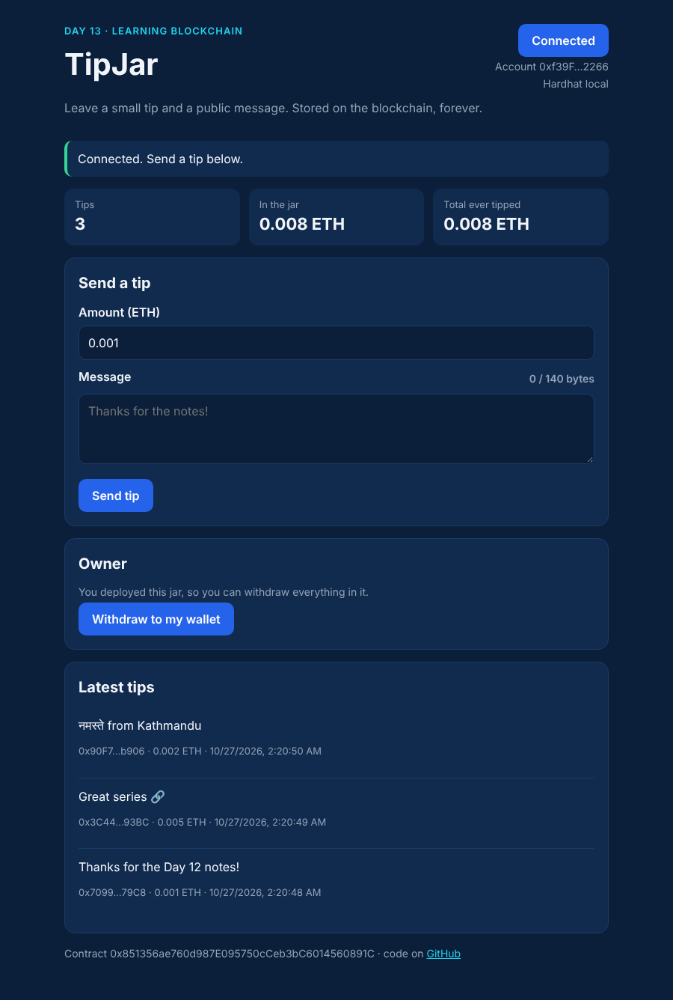
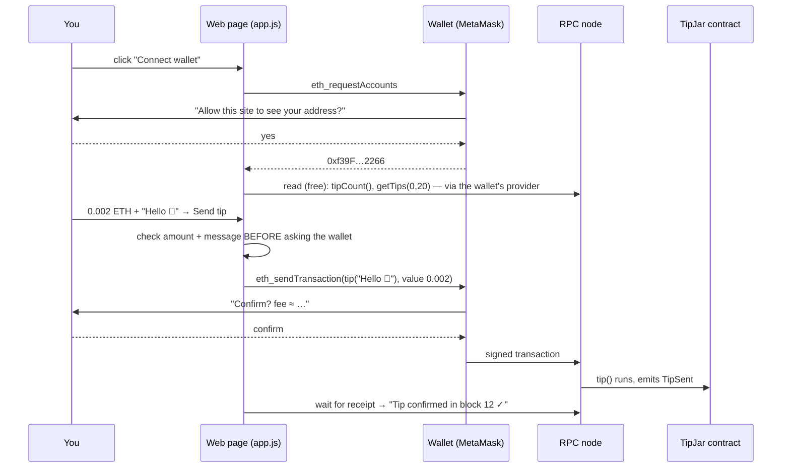

# Day 13 — A full-stack dApp: web page + wallet + contract

> Days 06–12 were contracts and tests. Nobody uses a contract through `npx hardhat test`. Today I built the **whole app**: a **TipJar** contract, a plain HTML/JS web page that talks to it through **MetaMask**, a deploy script for a local chain or the **Sepolia** test network (with secrets kept out of git), and **11 browser tests** that click the real page in Chromium. A tip costs **128,824 gas** on average, and a message containing `` shows up as harmless text.



## The idea in plain words

A **dApp** (decentralised app) is a normal website whose "back end" is a smart contract. Three parts work together:

| Part | What it does | Everyday comparison |
|---|---|---|
| **Web page** (HTML + JS + ethers.js) | Shows buttons and data, builds the transaction | The shop counter |
| **Wallet** (MetaMask) | Holds your private key, shows "Confirm?", signs | Your bank card + PIN: the shop never sees the PIN |
| **RPC node + contract** | Receives the signed transaction, runs the contract | The bank that actually moves the money |

The page **never touches a private key**. It asks the wallet, and the wallet asks *you*. That is the most important design rule of any dApp.



### Reading vs writing

| | Reading (`view` functions) | Writing (transactions) |
|---|---|---|
| Example | `getTips(0, 20)`, `tipCount()` | `tip("hi")`, `withdraw(to)` |
| Costs gas? | No | Yes (paid by the sender) |
| Needs a signature? | No | Yes: the wallet pops up |
| Speed | Instant | Wait for a block (~12 s on Sepolia) |

### Local chain vs Sepolia vs mainnet

| | Hardhat local (`npm run node`) | Sepolia testnet | Ethereum mainnet |
|---|---|---|---|
| Chain id | 31337 | 11155111 | 1 |
| ETH | 10,000 fake ETH × 20 accounts | Free from a faucet, worthless | Real money |
| Who sees it | Only your computer | Everyone (Etherscan) | Everyone |
| Use it for | Building + tests | Rehearsal with real network delays | Production |

### Keeping secrets out of git

Deploying to Sepolia needs a **private key**. A key pushed to GitHub is found by bots within minutes. The rules I followed:

```
.env.example   ← committed: placeholders only, explains what to fill in
.env           ← NOT committed (.gitignore): your real RPC URL + test-wallet key
hardhat.config ← loads .env, validates it (scripts/env.js), never prints the key
frontend/config.js ← generated by the deploy script: ABI + addresses = PUBLIC data only
```

`scripts/env.js` refuses an `http://` RPC URL, a key that isn't 32 bytes, the untouched placeholders, and Hardhat's **public** test key (the one printed by `npx hardhat node` that everyone on the internet knows).

## What I built

| Contract rule (`TipJar.sol`) | Why |
|---|---|
| Tip ≥ 0.0001 ETH | Spam costs something (and the money goes to the jar) |
| Message 1–140 **bytes** | Storage costs gas per byte. An emoji is 4 bytes, `नमस्ते` is 18 |
| `getTips(offset, limit)` newest first, max 50 | The page asks for small pages, so no call can get too big (Day 09 DoS) |
| Plain ETH sends refused | Every tip has a message and an event the page can show |
| Only the owner can `withdraw`, whole balance, checks-effects-interactions | Day 06 / Day 09 rules; a re-entrant owner contract gets nothing extra |

| Frontend rule (`frontend/app.js`) | Why |
|---|---|
| Tip messages shown with `textContent`, **never** `innerHTML` + a strict Content-Security-Policy | Messages are written by strangers. HTML in them must stay text (XSS) |
| Check amount + message in the page first | Fail fast, before the wallet pops up and before any gas is spent |
| Translate errors into one plain sentence | `4001` → "You cancelled", `TipTooSmall` → "The smallest tip is 0.0001 ETH" |
| Check the chain id, and that **code exists** at the configured address | Wrong network or a restarted local node must give a clear message, not a crash |
| `chainChanged` → reload; `accountsChanged` → set up again (only one timer) | MetaMask's own advice; see QA finding L1 |
| Button disabled while a transaction is pending | No accidental double tips |

## Code

Solidity compiles **offline** with solcjs (see [`tools/README.md`](../tools/README.md)). Everything runs locally; nothing in this folder needs an internet connection.

```bash
cd day-13
npm install
npm start               # scripted tour on an in-memory chain: deploy, 3 tips, 5 mistakes, withdraw
npm test                # 45 tests: contract, fuzz, deploy/env/server, 11 browser E2E tests
npm run lint            # ESLint (bans innerHTML in the frontend) + Solhint
npm run slither         # static analysis (after npm run compile)
```

**Try the dApp yourself (local chain + MetaMask):**

```bash
npm run node            # terminal 1: local chain on http://127.0.0.1:8545 (chain id 31337)
npm run deploy:local    # terminal 2: deploy TipJar, writes frontend/config.js
npm run serve           # terminal 2: open http://127.0.0.1:5173
```

In MetaMask: add a network with RPC `http://127.0.0.1:8545` and chain id `31337`, then import one of the test keys printed by `npm run node` (**test only**, never send real funds to them). After restarting the node, run `deploy:local` again.

**Deploy to Sepolia (optional):** `cp .env.example .env`, fill in an RPC URL (Infura/Alchemy/any provider) and the key of a **fresh** wallet that holds only free Sepolia ETH from a faucet, then `npm run deploy:sepolia`. The script adds the Sepolia address to `frontend/config.js` next to the local one, and the page links each tipper to Sepolia Etherscan. To put the page online, host `frontend/` on any static host and make it send the same security headers as `src/serve.js` (`X-Frame-Options: DENY`, `frame-ancestors 'none'`, `nosniff`). (This environment can't reach public RPCs, so I ran and tested everything on the local network; the Sepolia path is covered by the config/env tests.)

| File | What it is |
|---|---|
| [`contracts/TipJar.sol`](contracts/TipJar.sol) | The contract: tips with messages, paged reads, owner withdraw |
| [`frontend/index.html`](frontend/index.html), [`app.js`](frontend/app.js), [`style.css`](frontend/style.css) | The dApp: no framework, no build step; ethers v6 is served from `frontend/vendor/` |
| [`frontend/config.js`](frontend/config.js) | Generated: ABI + address per chain id (public data only) |
| [`scripts/deploy.js`](scripts/deploy.js) | Deploys, waits for confirmation, merges the address into the config |
| [`scripts/env.js`](scripts/env.js), [`.env.example`](.env.example) | Validates Sepolia settings without ever printing the key |
| [`src/serve.js`](src/serve.js) | Tiny static server: `127.0.0.1` only, no path traversal, no framing |
| [`src/demo.js`](src/demo.js) | The `npm start` tour |
| [`test/`](test) | 01 contract · 02 fuzz · 03 deploy/env/server + QA findings · 04 browser E2E |
| [`QA.md`](QA.md) | Findings, fixes and the final tool output |

**How the browser tests work.** MetaMask can't be scripted here, so `test/04-e2e.test.js` puts a tiny stand-in wallet into the page: a `window.ethereum` object with the same interface MetaMask has ([EIP-1193](https://eips.ethereum.org/EIPS/eip-1193)). It forwards every request to the Hardhat chain, can switch accounts, and can "press Cancel". Everything else (HTML, `app.js`, ethers, the contract) is the real thing.

## Results from my run

`npm start`:

```
=== 1. Deploy (what scripts/deploy.js does) ===
  TipJar at 0x5FbDB2315678afecb367f032d93F642f64180aa3  gas 665179

=== 2. Three people send tips (what the Send button does) ===
  0x709979… tipped 0.001 ETH  "Thanks for the Day 12 notes!"  (28 characters = 28 bytes)  gas 136722
  0x3C44Cd… tipped 0.005 ETH  "Great series 🔗"  (14 characters = 17 bytes)  gas 102390
  0x90F79b… tipped 0.002 ETH  "नमस्ते from Kathmandu"  (21 characters = 33 bytes)  gas 147360

=== 3. Read it back (free: view calls cost no gas) ===
  #1 newest: 0.002 ETH "नमस्ते from Kathmandu"
  #2 newest: 0.005 ETH "Great series 🔗"
  #3 newest: 0.001 ETH "Thanks for the Day 12 notes!"
  tipCount 3 · in the jar 0.008 ETH

=== 4. Mistakes the frontend must explain in plain words ===
  tip of 0.00001 ETH         → TipTooSmall(10000000000000, 100000000000000)
  empty message              → EmptyMessage()
  141-byte message           → MessageTooLong(141, 140)
  Alice tries to withdraw    → NotOwner(0x70997970C51812dc3A010C7d01b50e0d17dc79C8)
  plain ETH send, no tip()   → UseTipFunction()

=== 5. Owner withdraws ===
  owner +0.008 ETH (gas 30214) · jar now 0.0 ETH

Average tip costs 128824 gas. At 1 gwei that is 0.000128824 ETH.
```

Why is the first tip dearer than the second? The first one also turns `totalTipped` from 0 into a number (a fresh storage slot costs ~20,000 gas, Day 05). The third one is dearest because its message is the longest in **bytes** (33), even though it isn't the longest in characters.

Local node + deploy script (`npm run node`, then `npm run deploy:local`):

```
network : localhost (chain 31337)
deployer: 0xf39Fd6e51aad88F6F4ce6aB8827279cffFb92266  balance 10000.0 ETH
TipJar  : 0x5FbDB2315678afecb367f032d93F642f64180aa3  (block 1, gas 665179)
wrote   : frontend/config.js
```

`npm run deploy:sepolia` without a `.env`:

```
Sepolia is not configured: SEPOLIA_RPC_URL is missing; DEPLOYER_PRIVATE_KEY is missing. See .env.example.
```

`npm test`: **45 passing** (~9 s, including the evening audit and exercises). The browser part:

```
  E2E — real frontend in Chromium + Hardhat chain
    ✔ connects, sends a tip through the form, and shows it from the chain
    ✔ XSS: a message that is HTML/JS is shown as plain text and never runs
    ✔ bad input is caught in the page BEFORE the wallet is asked (no transaction sent)
    ✔ user presses Cancel in the wallet → a plain message, nothing sent, form usable again
    ✔ owner sees Withdraw and it works; switching to another account hides it
    ✔ wrong network → explains it and offers a Switch button
    ✔ stale config (no contract at the address) → clear error, not a crash
    ✔ no wallet installed → tells the user to install one
    ✔ L1: two quick account switches leave exactly ONE polling timer (no leak, no double requests)
    ✔ Info: a message with a right-to-left override can't flip the address/amount line
    ✔ screenshot: 3 tips, desktop and phone width (saved to screenshots/)
```

Phone width (390 px), checked for no sideways scrolling: [`screenshots/dapp-phone.png`](screenshots/dapp-phone.png).

QA: 4 Low findings, all fixed with a proving test (a leaked polling timer, a config file that could be silently wiped, deploying to a chain that disappears, clickjacking). Details in [`QA.md`](QA.md).

## Key takeaways

1. **A dApp = web page + wallet + contract.** The page builds, the wallet signs, the chain runs. The page never sees a key.
2. **Reads are free and instant; writes cost gas and wait for a block.** Design the UI around that wait: "confirm in wallet" → "waiting for block" → "confirmed".
3. **Everything on-chain is user input.** A stranger wrote that tip message: render it as text, never as HTML, and add a CSP as a second lock.
4. **Validate in the page *and* in the contract.** The page is for kindness (fast, clear errors); the contract is for safety (anyone can skip the page).
5. **Secrets live in `.env`, never in git.** Commit `.env.example` with placeholders; the frontend config holds only public data.
6. **Wallets change under you.** Accounts and networks switch at any time; handle `accountsChanged` / `chainChanged` and check there is code at the address.

## References

- [ethers.js v6 docs: Getting started (BrowserProvider, contracts)](https://docs.ethers.org/v6/getting-started/)
- [MetaMask docs: Connect to MetaMask (EIP-1193 provider, events)](https://docs.metamask.io/wallet/how-to/connect/)
- [EIP-1193: Ethereum Provider JavaScript API](https://eips.ethereum.org/EIPS/eip-1193)
- [Hardhat docs: Deploying and network configuration](https://hardhat.org/hardhat-runner/docs/guides/deploying)
- [ethereum.org: Networks (Sepolia, faucets)](https://ethereum.org/en/developers/docs/networks/)
- [OWASP: Cross-site scripting prevention cheat sheet](https://cheatsheetseries.owasp.org/cheatsheets/Cross_Site_Scripting_Prevention_Cheat_Sheet.html)

## Evening update

A second, independent review looked hardest at the code that guards the deploy key, because a mistake there costs real money. It found **three Low problems**, each proven by a failing test first:

- **E1 — only one of Hardhat's 20 public keys was blocked.** The check refused account #0's key, but accounts #1–#19 come from the same public phrase. Pasting the key of account #1 was accepted as fine. Now all 20 are refused.
- **E2 — an all-zero key passed.** It has the right length, but it is not a valid private key. Now refused.
- **E3 — `https://` with no host name passed** as a valid RPC URL. The URL is now parsed properly.

The contract itself was attacked again (re-entrancy, huge page requests, emoji at the byte limit, 120 tips in pages) and held. Nothing changed there.

**One improvement to the morning code:** `npm run check:env` checks your `.env` for Sepolia **without deploying and without ever printing the key**, so you find a mistake before spending any gas.

Exercises (3, with tested solutions): [`exercises/`](exercises). Full findings: [QA.md](QA.md#evening-audit). Study guide: [`notes.pdf`](notes.pdf).

### What I'd explore next
- Replace the 8-second polling with event subscriptions, and add a "Load more" button that uses `getTips(offset, 50)`.
- Make the owner transferable in two steps (`Ownable2Step`) so a lost key does not lock the tips forever (known issue K1).

## Coming next

**Day 14 — Zero-knowledge proofs & account abstraction:** proving you know a secret without showing it, and smart-contract wallets (ERC-4337) that can have spending limits and recovery.
