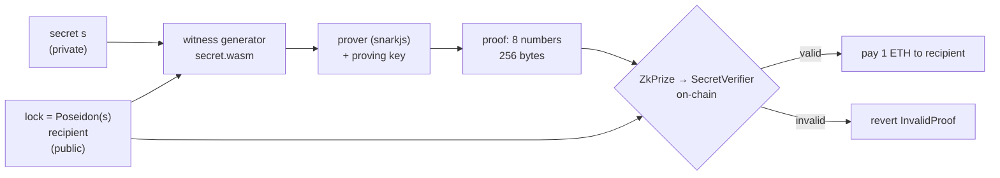
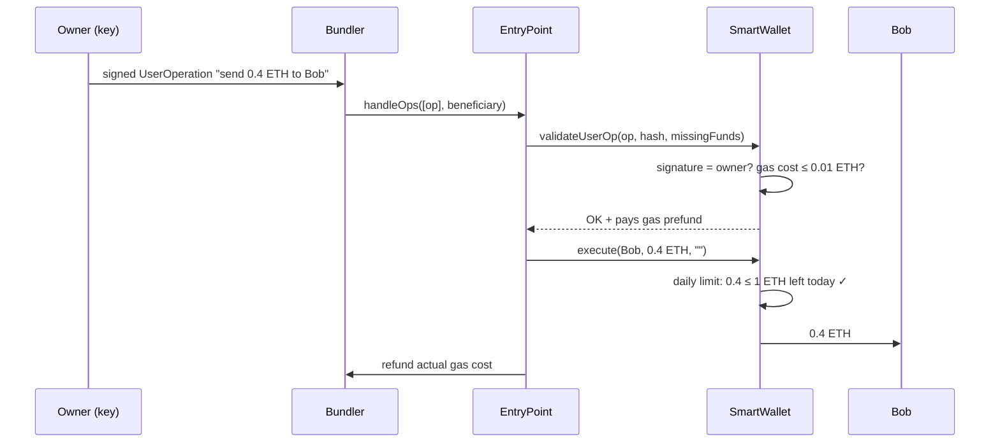

# Day 14 — Zero-knowledge proofs & smart-contract wallets (ERC-4337)

> Until now, everything on-chain was **public** and every account was **one key**. Today I broke both rules. First, a **zero-knowledge proof** (circom + snarkjs): I prove that I know a secret number **without showing it**, and a contract checks the proof on-chain and pays out 1 ETH. Second, an **ERC-4337 smart wallet**: a wallet that is a contract, with a **1 ETH/day spending limit** and a **guardian who can recover it** if the key is lost. The proof is always **256 bytes**, takes **~0.7 s** to build, and costs **258,782 gas** to verify and pay out.

## Part 1 — Zero-knowledge proofs in plain words

A **zero-knowledge proof** convinces someone that a statement is true **without revealing why**.

Everyday comparison: you want to prove you know the Wi-Fi password without saying it. You connect your phone and the router lets you in. Your friend now *knows that you know it*, but they still don't know the password.

Today's statement:

> "I know a secret number `s` such that `Poseidon(s)` = this public lock, and the prize should go to **this address**."

| Word | Meaning | Everyday comparison |
|---|---|---|
| **Circuit** (`circuits/secret.circom`) | The statement written as maths rules ("constraints") | A form with boxes that must add up |
| **Witness** | All the numbers that fill the form, including the secret | Your filled-in form (stays at home) |
| **Proof** | 8 numbers (256 bytes) that show the form was filled correctly | A stamp from a notary who saw the form |
| **Verifier** (`contracts/verifiers/SecretVerifier.sol`) | Code that checks the stamp; generated by snarkjs | The bank checking the stamp is real |
| **Public signals** | The numbers everybody sees: `[lock, recipient]` | What's written on the outside of the envelope |
| **Poseidon** | A hash designed for circuits (SHA-256 needs ~100× more constraints) | Day 01's fingerprint, but cheap to prove |
| **Trusted setup** | Creates the proving/verification keys once per circuit | Making the notary's stamp; the mould must be destroyed |



The circuit is only a few lines. It has 416 constraints, almost all of them inside Poseidon:

```circom
template ProveSecret() {
    signal input secret;      // PRIVATE
    signal input hash;        // public
    signal input recipient;   // public: binds the proof to one address
    component h = Poseidon(1);
    h.inputs[0] <== secret;
    hash === h.out;                       // the rule: Poseidon(secret) must equal the lock
    signal recipientSquare;
    recipientSquare <== recipient * recipient;  // keep recipient inside a real constraint
}
component main {public [hash, recipient]} = ProveSecret();
```

### Why the proof must name the recipient (front-running)

A proof is just data. Before it is mined, it sits in the **public mempool**. In the **naive** version (`secret_naive.circom` + `NaiveZkPrize.sol`), the proof only says "someone knows the secret", and the prize goes to `msg.sender`. Mallory copies Alice's proof, pays a higher fee, and **takes the 1 ETH without knowing anything** (test `02-frontrun`). The fix is to make the recipient a public input. If Mallory changes it to her own address, the proof stops matching.

| | Naive prize | Safe prize (`ZkPrize`) |
|---|---|---|
| Mallory copies the proof, puts her own address | wins 1 ETH | `InvalidProof` |
| Mallory resends it unchanged | wins 1 ETH | pays the gas, **Alice** gets the 1 ETH |
| A relayer submits it for Alice (gasless) | relayer is paid | Alice is paid ✓ |

### What ZK does *not* protect

- **A guessable secret.** The lock is public, so anyone can hash guesses. I brute-forced a 4-digit PIN in **4,822 tries / 257 ms**. `randomSecret()` uses 248 random bits.
- **A dishonest setup.** Groth16's setup creates "toxic waste". Whoever keeps it can forge proofs. My setup has one contributor (fine for learning). Real projects run a multi-party ceremony, where one honest participant is enough.

## Part 2 — Account abstraction (ERC-4337) in plain words

A normal Ethereum account (**EOA**) *is* its private key. Lose the key and the money is gone. Steal the key and you can spend everything at once. A **smart wallet** is a **contract** that holds the money and sets its own rules. Comparison: an EOA is cash in your pocket, and a smart wallet is a bank account with a daily ATM limit and a recovery desk.

ERC-4337 adds this **without changing Ethereum itself**:

| Piece | Job | Everyday comparison |
|---|---|---|
| **UserOperation** | A signed "please do this" from the owner (not a transaction) | A signed cheque |
| **Bundler** | Collects many UserOperations, sends one `handleOps` transaction, pays gas up front | A courier carrying many cheques to the bank |
| **EntryPoint** (one official contract per chain) | Checks each op with the wallet, then runs it, then refunds the bundler from the wallet | The bank clerk |
| **Smart wallet** (`SmartWallet.sol`) | `validateUserOp`: "is this signature mine?" · `execute`: do it, within my rules | Your account and its rules |
| **Paymaster** (not used today) | Pays gas for the user (e.g. a dApp sponsoring its users) | A company card |



My wallet's rules:

| Rule | Where | Why |
|---|---|---|
| Owner signature over `getUserOpHash` (includes chain id + EntryPoint) | `_validateSignature` | No one else can act, and a signed op can't be replayed on another chain |
| Bad signature → return `SIG_VALIDATION_FAILED`, never revert | `_validateSignature` (`tryRecover`) | Bundlers simulate ops; the EntryPoint reports `AA24` |
| Nonce kept by the EntryPoint | `BaseAccount` | Replay → `AA25` |
| ≤ **1 ETH per day** leaves | `execute → _spend` | A thief with the key can't empty it at once |
| Max gas cost per op **0.01 ETH**; no calls to the EntryPoint | `validateUserOp`, `execute` | QA finding **M1**: gas was a way around the limit |
| Owner can only **lower** the limit; the guardian can raise it | `setDailyLimit` | Raising the limit is exactly what a thief would do first |
| Guardian recovery after **2 days**; the owner can cancel | `startRecovery / cancelRecovery / finishRecovery` | Lost key → recover; malicious guardian → owner has 2 days to say no |

### The bug the QA review found (M1)

The limit was checked in `execute`. But the wallet also pays **gas** in `validateUserOp`, which runs *before* `execute`, and the signer picks the gas price. A thief signed an op with an absurd fee. The wallet sent a **4.5 ETH** prefund to the EntryPoint, most of which stayed there as a deposit. The thief then pulled it out with `EntryPoint.withdrawTo` through `execute` with `value = 0`. **4.5 ETH left a wallet with a 1 ETH/day limit.** Fix: cap the gas cost per op at 0.01 ETH, and forbid `execute` from calling the EntryPoint. Details and the tests are in [QA.md](QA.md).

## Code

Solidity compiles **offline** with solcjs (see [`tools/README.md`](../tools/README.md)). Circuits compile with `circom2` (circom as WebAssembly, from npm). Everything runs on the local Hardhat network.

```bash
cd day-14
npm install
npm start            # the tour: ZK prize (incl. a stolen proof) + smart wallet (limit, replay, recovery)
npm test             # 52 tests: ZK, front-running race, ERC-4337 flows, fuzz, QA attacks, evening audit, exercises
npm run lint         # ESLint + Solhint
npm run slither      # static analysis (after npm run compile)
npm run zk:setup     # OPTIONAL: recompile circuits, redo the trusted setup, regenerate verifiers
```

The keys in `zk/` and the verifiers in `contracts/verifiers/` are committed, so `npm test` works without running the setup. If you run `zk:setup`, it makes **new** random keys and regenerates both verifiers to match.

| File | What it is |
|---|---|
| [`circuits/secret.circom`](circuits/secret.circom) | The circuit: Poseidon(secret) = lock, recipient bound |
| [`circuits/secret_naive.circom`](circuits/secret_naive.circom) | Same without a recipient (for the front-running demo) |
| [`scripts/zk-setup.js`](scripts/zk-setup.js) | compile → powers of tau → Groth16 keys → Solidity verifier |
| [`contracts/ZkPrize.sol`](contracts/ZkPrize.sol) / [`NaiveZkPrize.sol`](contracts/NaiveZkPrize.sol) | Pays whoever proves the secret (safe vs naive) |
| [`contracts/SmartWallet.sol`](contracts/SmartWallet.sol) | The ERC-4337 wallet (built on the official v0.7 `BaseAccount`) |
| [`src/zk.js`](src/zk.js) | Poseidon, prove, verify, format a proof for Solidity |
| [`src/userop.js`](src/userop.js) | Build + sign UserOperations, play the bundler |
| [`src/demo.js`](src/demo.js) | `npm start` |
| [`test/`](test) | 01 ZK · 02 front-running · 03 wallet · 04 fuzz · 05 QA attacks |
| [`QA.md`](QA.md) | Findings, fixes, tool output |

## Results from my run

`npm start`:

```
=== Part 1. Zero-knowledge: prove you know a secret without showing it ===
  secret (stays on Alice's laptop): 248 random bits
  public lock = Poseidon(secret)  : 115309891469…
  ZkPrize deployed holding 1 ETH, it stores only the lock

  Alice builds a proof in 642 ms — 256 bytes (8 numbers), whatever the secret
  public signals: [lock, Alice's address]  — the secret is not in there
  off-chain check with the verification key: true
  Mallory copies the proof but names herself → rejected: InvalidProof
  a relayer submits Alice's proof → Alice +1 ETH, on-chain verification + payout gas 258782
  BUT a 4-digit PIN as the secret: found 4821 by trying 4822 guesses in 257 ms

=== Part 2. Account abstraction (ERC-4337): a wallet that is a contract ===
  SmartWallet: 3 ETH, owner key signs, daily limit 1 ETH, guardian can recover after 2 days
  1. owner signs "send 0.4 ETH to Bob" → bundler → EntryPoint: success=true, op gas 183741, bundle tx gas 176044
     the WALLET paid the fee (0.000250234747345119 ETH); the bundler's net: +0.000010482455468923 ETH
  2. Bob signs for the wallet → rejected: AA24 signature error
  3. the same signed op sent twice → rejected: AA25 invalid account nonce
  4. 0.6 ETH more today (limit left 0.5) → success=false (DailyLimitExceeded)
  5. key lost → guardian starts recovery, 2 days pass → new owner: true
     old key now → rejected: AA24 signature error
```

How to read Part 2. The wallet paid the gas, not Bob or the owner. The bundler earned a small amount for its work. The "op gas" (183,741) is more than the bundle transaction's gas (176,044) because the op is also charged its `preVerificationGas` (50,000), which pays the bundler for overhead such as calldata. In step 4 the op was still **paid for** even though the transfer failed: the EntryPoint charges for the work it did.

Circuit size (`npm run zk:setup`): `secret.circom` → **217 non-linear + 199 linear constraints**, 2 public inputs, 1 private input.

`npm test`: **52 passing** (~5 s). QA: **1 Medium (M1) and 2 Low (L1, L2) found and fixed**, 0 open high/medium, 7 known issues with reasons. Slither: 9 results, all Info. `npm audit --omit=dev`: 0 vulnerabilities. Full report: [QA.md](QA.md).

## Key takeaways

1. **ZK = "I can prove it without showing it."** The verifier learns one bit (true/false) plus the public signals, never the secret.
2. **Everything public in a proof must be on purpose.** If the proof doesn't name who gets paid, anyone can steal it from the mempool. Put the recipient (or `msg.sender`) into the public inputs.
3. **ZK doesn't make a weak secret strong.** If the secret can be guessed, the public hash gives it away. Use ≥128 random bits.
4. **Groth16 needs a trusted setup per circuit.** One-person setups are for learning only.
5. **A smart wallet is a contract with rules.** ERC-4337 runs it through UserOperations → bundler → EntryPoint, with no change to Ethereum.
6. **Validation is part of the attack surface.** Gas is paid in `validateUserOp`, before any `execute` rule runs. Limit what validation can spend.

## References

- [circom docs: Getting started & writing circuits](https://docs.circom.io/)
- [snarkjs (iden3) README: Groth16, powers of tau, Solidity verifier](https://github.com/iden3/snarkjs)
- [ethereum.org: Zero-knowledge proofs](https://ethereum.org/en/zero-knowledge-proofs/)
- [EIP-4337: Account Abstraction Using Alt Mempool](https://eips.ethereum.org/EIPS/eip-4337)
- [ERC-7562: Account Abstraction Validation Scope Rules](https://eips.ethereum.org/EIPS/eip-7562)
- [eth-infinitism/account-abstraction (official EntryPoint v0.7)](https://github.com/eth-infinitism/account-abstraction)

## Evening update

A second, independent review looked at who has to be a *different person* for the safety rules to mean anything, and at what a user could do to hurt themselves. Each finding was proven by a failing test first:

- **L1 (Low): owner and guardian could be the same address.** The guardian is the only one allowed to *raise* the daily limit. If one key is both, a thief with that key raises the limit and empties the wallet. The constructor and `startRecovery` now refuse it (`OwnerIsGuardian`), and recovering to the current owner is refused too (`AlreadyOwner`).
- **L2 (Low): a proof naming the prize contract as recipient locked the ETH forever.** `ZkPrize.claim` now refuses `recipient == address(this)`.
- **K7 (known, not fixed): "per day" means per UTC calendar day.** I sent 1 ETH at 23:59:30 and 1 ETH at 00:00:05: both passed, so 2 ETH left in 35 seconds. The test documents it, and exercises 2 and 3 build the fix as a tested model (a rolling 24 h window).

Result: `npm test` → **52 passing** (43 contract tests + 9 exercise tests), ESLint and Solhint clean, 0 audit vulnerabilities, Slither 9 results all Info. Details in [QA.md](QA.md#evening-audit).

### Exercises
Three exercises (easy, medium, challenge) with tested solutions: [`exercises/README.md`](exercises/README.md). Run `npm run ex`.

### What I'd explore next
- Build the rolling-window limit in Solidity with 24 hourly buckets, and fuzz it against the JavaScript model from exercise 3.
- Let the guardian be changed (and use two or three guardians, M-of-N) with a delay, so one lost guardian key does not break recovery (known issue K2).
- Add a paymaster and a wallet factory with `initCode`, so a new user can start with no ETH (known issue K5).

## Coming next

**Day 15 — Capstone:** an on-chain certificate verification dApp. An issuer role can issue and revoke certificates, anyone can verify one by its hash, there is a frontend, and the day ends with a professional self-audit report of the whole project.
