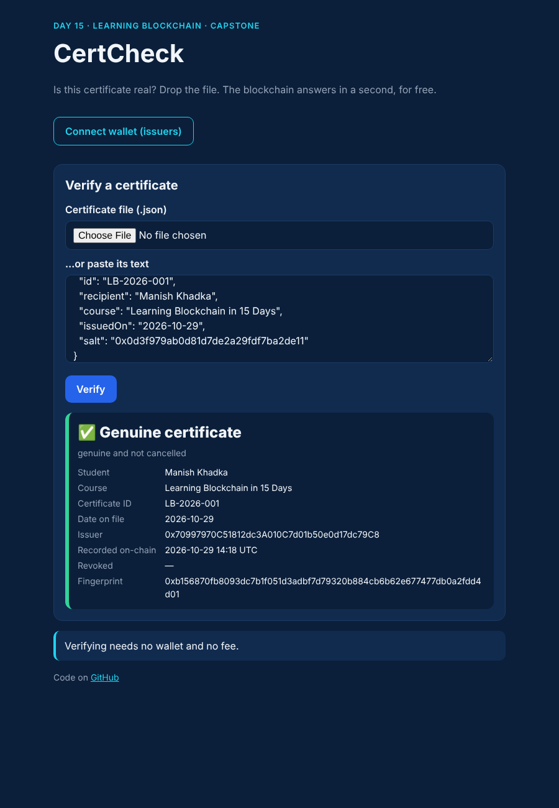
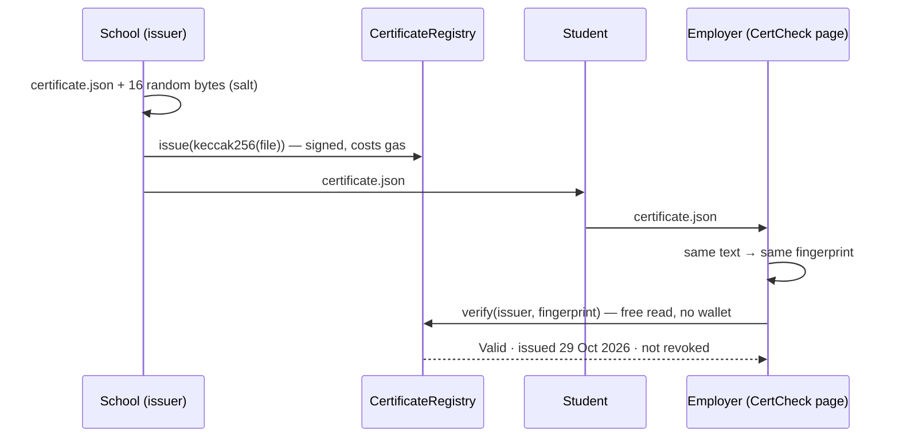
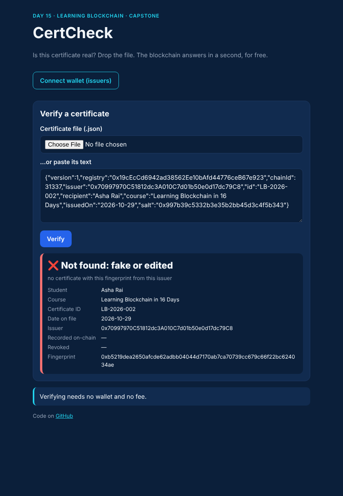
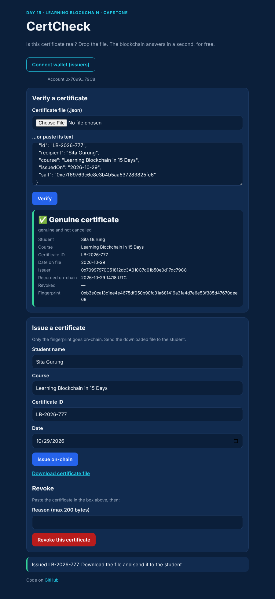

# Day 15 — Capstone: a certificate you can check on the blockchain

> Fifteen days ago I started with one hash. Today everything comes together in one real app: **CertCheck**. A school writes the **fingerprint** of each certificate to a smart contract. Anyone can drop the certificate file into a web page and learn in about **2 ms, for free**, whether it is genuine, edited, or cancelled. Then I attacked my own design like an auditor would: the review found **3 Medium bugs and 1 Low**, all reproduced with tests and fixed. The write-up is in **[AUDIT.md](AUDIT.md)**.



## The idea in plain words

Fake degrees and certificates are a real problem. Checking one today usually means emailing the university and waiting days.

CertCheck works like a **public notice board that nobody can secretly edit**:

| Step | Who | What happens | Everyday comparison |
|---|---|---|---|
| 1. Issue | School | Makes a certificate file and writes its **fingerprint** (hash, Day 1) to the registry contract | Pinning a sealed receipt on a public board |
| 2. Share | Student | Sends the file to an employer, like any PDF | Handing over your certificate |
| 3. Verify | Employer | Drops the file into the page; the page recomputes the fingerprint and asks the contract | Comparing the receipt with the one on the board |
| 4. Revoke | School | Marks a certificate as cancelled (with a reason) | Stamping "CANCELLED" on the board |

Change **one letter** in the file → a completely different fingerprint → **"Not found: fake or edited"**.



### What goes on-chain — and what doesn't

| On-chain (public forever) | Only in the file (private) |
|---|---|
| 32-byte fingerprint, issue time, revoke time | Student name, course, certificate ID, date |
| Issuer address | A 16-byte random **salt** |

Why the salt? A hash hides data only if it can't be guessed. Without a salt, anyone who knows "Manish Khadka, Learning Blockchain, 29 Oct" could hash that guess and confirm it — my attack test found a student among 1,000 guessed names. With 16 random bytes there are 2¹²⁸ possibilities per guess: hopeless.

### One exact text for every certificate ("canonical JSON")

`{"a":1,"b":2}` and `{"b":2,"a":1}` mean the same thing but are different bytes, so different hashes. The library writes every certificate **one** way: keys sorted, no spaces, text trimmed and Unicode-normalised. Fuzz tests check 2,000 random certificates: reordering never changes the hash, a real change always does.

### Who can do what

| | Issue | Revoke | Verify |
|---|:-:|:-:|:-:|
| Admin (should be a multisig) | ✗ (unless it makes itself an issuer — visible to all) | ✅ any | ✅ |
| Issuer (a school) | ✅ | ✅ its own, while still an issuer | ✅ |
| Anyone else | ✗ | ✗ | ✅ free |

### How this capstone uses every day of the series

| Day | Used here |
|---|---|
| 01 Hashing | the certificate's fingerprint (keccak256) |
| 02 Blocks & chains | the record can't be quietly changed later |
| 03 Keys & signatures | issuers sign with their wallet; the page never sees a key |
| 04 Consensus | everybody reads the same registry |
| 05–06 EVM & Solidity | the contract, custom errors, one storage slot per certificate |
| 09 Security | access control, front-running (M1), the attacker checklist |
| 11 Gas | `uint40` packing, batch issuing: 25,549 gas each instead of 70,391 |
| 13 Full-stack dApp | the page, MetaMask, deploy script, `.env` kept out of git |
| 14 Zero-knowledge | same lesson as the cracked 4-digit PIN: a hash hides data only if it can't be guessed → the salt |

## What I built

| File | What it is |
|---|---|
| [`contracts/CertificateRegistry.sol`](contracts/CertificateRegistry.sol) | The registry: roles (OpenZeppelin `AccessControl`), `issue`, `issueBatch` (≤100), `revoke` with a reason, free `verify` |
| [`contracts/v1/CertificateRegistryV1.sol`](contracts/v1/CertificateRegistryV1.sol) | My **first** design, kept only to replay bug M1. Do not use |
| [`src/certificate.js`](src/certificate.js) | Build, validate, canonicalise and hash a certificate (Node + browser) |
| [`src/verify.js`](src/verify.js) | The full verifier check: file valid → right registry & chain → right issuer → status |
| [`frontend/`](frontend) | CertCheck page: verify by file or paste (no wallet needed on the local chain); issuers connect MetaMask to issue, download the file, and revoke |
| [`scripts/deploy.js`](scripts/deploy.js) | Deploy to a local node or Sepolia (`.env`, see [`.env.example`](.env.example)); writes `frontend/config.js` with public data only |
| [`test/`](test) | 46 tests: unit, fuzz, attacks, browser E2E, deploy & secrets, evening audit, exercises |
| [`QA.md`](QA.md) · [`AUDIT.md`](AUDIT.md) | Findings table · professional self-audit report |

### The bugs my own review found

| ID | In plain words | Fix |
|----|----------------|-----|
| **M1** | In my first design, another school could copy my pending "issue" from the waiting room (mempool), pay a higher fee, and become the "issuer" of my student's certificate. My real transaction failed. | Each issuer has its own column; the file names its issuer. |
| **M2** | A forger can deploy a **copy** of the contract where they are the boss and "issue" anything. | The file names its registry and chain; the verifier refuses any other. |
| **M3** | A school whose key was stolen gets removed — but the thief could still **cancel** all its real certificates. | Only an *active* issuer (or the admin) can revoke. |
| **L1** | The form's default date was UTC: in Nepal, before 5:45 am it showed **yesterday**. | Use the local date. |

## Code

```bash
cd day-15
npm install
npm start            # the whole story on a local chain, with gas numbers
npm test             # 46 tests (Playwright + Chromium needed for the 8 browser tests)
npm run fuzz         # property tests only
npm run attacks      # the QA findings, reproduced
npm run lint         # ESLint + Solhint
npm run slither      # static analysis (pip install slither-analyzer)

# run the dApp locally
npm run node                  # terminal 1: local chain on 127.0.0.1:8545
npm run deploy:local          # terminal 2: deploy + make account #0 an issuer
npm run serve                 # open http://127.0.0.1:5173
# MetaMask: add network http://127.0.0.1:8545 (chain 31337), import Hardhat account #0 (LOCAL ONLY)

# Sepolia (optional): copy .env.example to .env, fill in, then
npm run check:env && npm run deploy:sepolia
```

## Results from my run

```
== 1. The school issues certificates ==
certificate file (canonical text):{"chainId":31337,"course":"Learning Blockchain in 15 Days","id":"LB-20…
fingerprint stored on-chain:      0x1805c7d91877fd10ad403dd54683178c18e772591df82a291b9b3ec763351e08
bytes of personal data on-chain:  0 (only the 32-byte fingerprint)
gas: deploy registry              755,992
gas: issue 1 certificate          70,391
gas: issue a class of 30 (batch)  766,567 (25,552 each)
certificates issued:              31

== 2. An employer checks the file Manish sent ==
verdict:                          VALID — genuine and not cancelled (1.7 ms, free: no transaction)

== 3. A forger changes ONE letter ==
verdict:                          NOT_FOUND — no certificate with this fingerprint from this issuer
fingerprint now:                  0xe3ede736ea4d811fdffa44187e38dda7619f121c546aad3fe4cee4c9c581e61d

== 4. The school cancels a certificate ==
verdict:                          REVOKED — the issuer cancelled this certificate
gas: revoke                       56,087

== 5. Someone who is not an issuer tries to issue ==
result:                           rejected — AccessControlUnauthorizedAccount
```

(The salt is random, so the fingerprints differ on every run; the gas numbers don't.)

An example certificate file from this run: [`examples/certificate-LB-2026-001.json`](examples/certificate-LB-2026-001.json).

Tests (`npm test`, after `hardhat clean`):

```
  CertificateRegistry                       13 passing
  Fuzz — certificate fingerprint             3 passing (3,000 random certificates)
  Fuzz — contract matches a simple model     1 passing (60 random sequences × 25 steps)
  Attacks (M1, M2, M3, privacy, DoS, files)  7 passing
  E2E — real page in Chromium                8 passing
  Deploy script & secrets                    4 passing
  Evening audit (L2)                         3 passing
  Exercises                                  7 passing
  46 passing (16s)
```

| Screen | |
|---|---|
| Fake (one word changed) |  |
| Issuer view |  |

## Evening update

I read the contract again as a stranger who did not write it, and ran every tool again (ESLint, Solhint, `npm audit`, Slither, all tests on a clean build).

- **L2 (Low): the registry could be left with no admin, forever.** The only admin could call `renounceRole` (or `revokeRole` on itself) by mistake, or a thief with the key could do it on purpose. After that nobody could add or remove issuers, and nobody could cancel the certificates of a stolen issuer key (the M3 emergency button would be gone). A new test showed the lock-out; the contract now counts admins (`adminCount`) and refuses to remove the last one (`LastAdmin`). Handing over still works: add the new admin first, then the old one leaves.
- Everything else I tried held: hostile files, look-alike registries, replaying a revoked certificate, huge batches, XSS, a leaked key in git. Details in [QA.md](QA.md#evening-audit).

Result: `npm test` → **46 passing** (36 morning + 3 audit + 7 exercises), lint clean, 0 audit vulnerabilities, Slither 3 results (the same triaged false positives).

Cost of the fix: deploying the registry now costs 755,992 gas instead of 677,764 (+78,228, once); issuing one certificate is unchanged (70,391).

### Exercises
Three exercises (easy, medium, challenge) with tested solutions: [`exercises/README.md`](exercises/README.md). Run `npm run ex`.

### What I'd explore next
- Make the admin a multisig (Safe) and switch to OpenZeppelin `AccessControlDefaultAdminRules` (two-step, delayed admin hand-over).
- Show vetted school names next to issuer addresses (exercise 2 is the first step).
- Deploy to Sepolia and let a friend verify a certificate from their phone.

## Key takeaways

1. **Put fingerprints on-chain, not people.** A salted hash proves a document exists without publishing it.
2. **"Is this hash valid?" is the wrong question.** Ask "valid in *which* registry, on *which* chain, from *which* issuer?" — otherwise copies of your contract fool you (M2).
3. **Anything in the mempool can be copied and front-run.** Design storage so a copy can't hurt you (M1).
4. **Removing a role must remove *all* its powers.** M3 hid in the one function that didn't check the role.
5. **Audit like an attacker, then prove it.** Every finding has a test that failed before the fix and passes after.
6. **A self-audit is a start, not a stamp.** Real value needs an independent audit and a multisig admin.

## References

- [OpenZeppelin — Access Control (`AccessControl`, `AccessControlDefaultAdminRules`)](https://docs.openzeppelin.com/contracts/5.x/access-control)
- [Solidity docs — Layout of state variables in storage (packing)](https://docs.soliditylang.org/en/v0.8.24/internals/layout_in_storage.html)
- [Ethereum.org — Maximal extractable value (MEV) & front-running](https://ethereum.org/en/developers/docs/mev/)
- [RFC 8785 — JSON Canonicalization Scheme](https://www.rfc-editor.org/rfc/rfc8785)
- [Blockcerts — open standard for blockchain credentials](https://www.blockcerts.org/guide/)
- [Slither — static analyzer for Solidity](https://github.com/crytic/slither)

## Coming next

That was the last day of the series. The look back at all 15 days is in the [root README](../README.md#retrospective--15-days-of-learning-blockchain).
