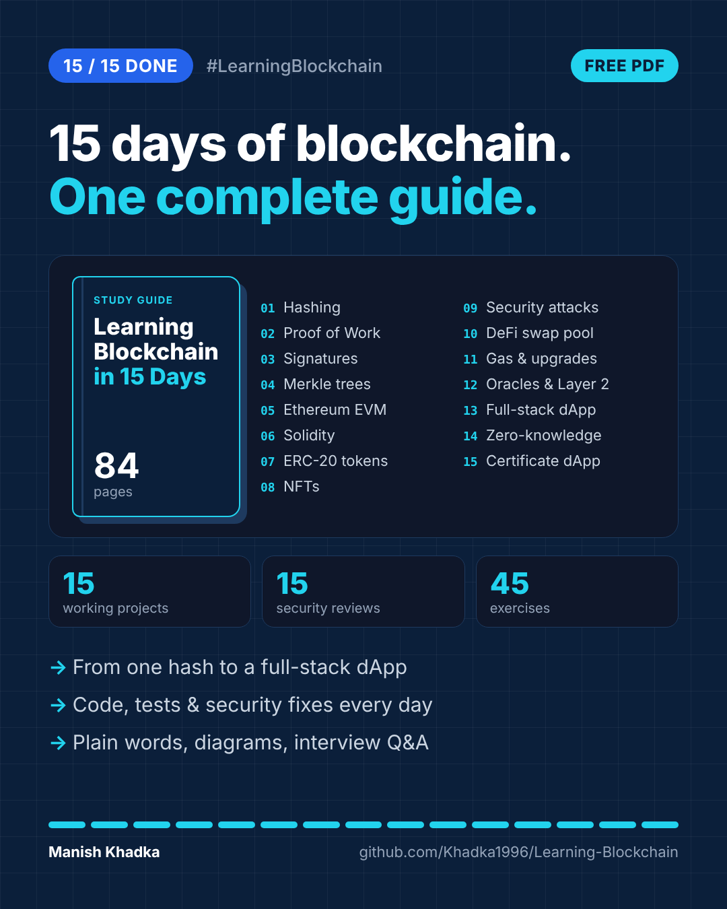

# Learning Blockchain in 15 Days — Complete Study Guide (Free PDF)

**[📘 Download the free PDF (84 pages)](Learning-Blockchain-Complete-Study-Guide.pdf)**

A free, beginner-to-advanced **blockchain development study guide** that goes from a single SHA-256 hash to a full-stack Ethereum dApp in 15 days. It covers hashing, Proof of Work, digital signatures, Merkle trees, the Ethereum Virtual Machine (EVM), Solidity smart contracts, ERC-20 tokens, NFTs (ERC-721 / ERC-1155), smart-contract security, DeFi (an AMM built from scratch), gas optimisation, upgradeable proxies, oracles, Layer 2 rollups, bridges, zero-knowledge proofs and ERC-4337 account abstraction.

Written in plain language for developers, students and anyone curious about Web3. Every chapter is backed by real, tested code in this repository.

## What every chapter includes

- Learning objectives
- The concept, step by step, in plain words with diagrams
- A walkthrough of the key code
- Real results from running the code
- QA and security findings: what broke and how it was fixed
- Common mistakes and 5 interview questions with answers
- Exercises (easy, medium, challenge)
- A one-box cheat sheet and authoritative references

The guide also includes an overview of the whole journey, 5 lessons learned, next steps and a glossary of about 30 key blockchain terms.

## Contents

| Day | Topic | Page |
|----:|-------|----:|
| 01 | [Hashing & SHA-256](../day-01) | 4 |
| 02 | [Blocks, chains & Proof of Work](../day-02) | 10 |
| 03 | [Keys, signatures & transactions](../day-03) | 16 |
| 04 | [Merkle trees, forks & consensus](../day-04) | 22 |
| 05 | [Ethereum & the EVM](../day-05) | 28 |
| 06 | [Solidity fundamentals](../day-06) | 33 |
| 07 | [ERC-20 tokens](../day-07) | 39 |
| 08 | [NFTs: ERC-721 & ERC-1155](../day-08) | 45 |
| 09 | [Smart-contract security](../day-09) | 50 |
| 10 | [DeFi: AMM from scratch](../day-10) | 55 |
| 11 | [Gas optimisation & upgradeable contracts](../day-11) | 59 |
| 12 | [Oracles, Layer 2 & bridges](../day-12) | 64 |
| 13 | [Full-stack dApp](../day-13) | 69 |
| 14 | [Zero-knowledge & account abstraction](../day-14) | 74 |
| 15 | [Capstone: certificate dApp + self-audit](../day-15) | 78 |
| — | What I learned: lessons, glossary & next steps | 82 |

Each day's chapter is also available on its own as `day-XX/notes.pdf`.

## Author

**Manish Khadka**, Full Stack Developer and Team Lead, Kathmandu, Nepal
[khadka-manish.com.np](https://khadka-manish.com.np) · [LinkedIn](https://www.linkedin.com/in/manishkhadka1996) · [GitHub](https://github.com/Khadka1996)

Free to read and share. Corrections and suggestions are welcome — open an issue.
